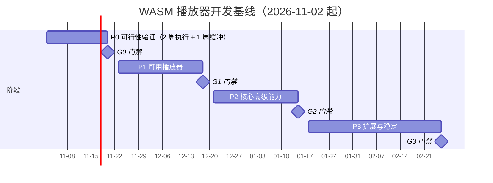
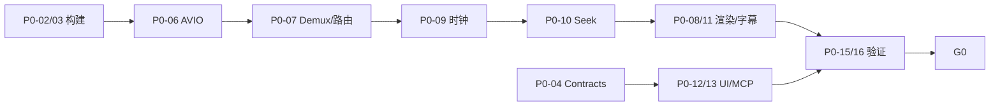

# WASM 视频播放器开发方案与开发计划

> 依据：`docs/superpowers/specs/2026-11-02-wasm-player-design.md`
>
> 状态：评审稿 v1.0，评审通过后作为执行基线
>
> 编制日期：2026-11-02
>
> 计划范围：P0–P3；P4 作为 G3 后的独立评估项
>
> 资源假设：2 名全职开发、0.5 FTE 共享测试、0.2 FTE 架构/安全/许可评审
>
> 计划原则：P0 先验证；P1–P3 滚动承诺；所有能力以构建清单、样本回归和实测结果为准

---

## 0. 一页结论

**技术路线。** 采用混合播放管线：FFmpeg/WASM 负责解封装与软件解码兜底，WebCodecs 承担浏览器可用的音视频解码，WebGL2 作为首版渲染后端、WebGPU 作为增强后端，AudioWorklet 负责连续音频输出。控制面采用 ports-and-adapters，Controller 独占播放状态，UI、快捷键、命令面板、SDK、MCP 共用同一个命令注册表。

**交付节奏。** P0 用 2 周执行加 1 周缓冲回答可行性问题，G0 在 2026-11-20 做 go/no-go；P1 用 4 周交付可用 Web 播放器，G1 在 2026-12-18；P2 用 4 周交付核心高级能力，G2 在 2027-01-15；P3 用 5 个净工作周交付扩展与稳定能力，G3 在 2027-02-26。P4 桌面封装不进入本基线。

**承诺方式。** P0 任务、验收和门禁在本稿中固定；P1–P3 只承诺到下一个门禁，G0 后按实测速率重排。P3 是能力包集合，不是全量承诺，具体包序在 G2 按需求和证据决定。

**关键路径。** 固定工具链与 WASM 构建 → SourceReader/AVIO → Demux/Probe → 解码路由 → 时钟/Seek/队列 → 渲染/音频 → 命令注册表/UI/SDK/MCP 集成。P0 任何一环失败都必须在 G0 前给出替代方案，不允许带病进入 P1。

**当前环境事实。** 仓库为空且未初始化 Git；实测环境为 Deepin 25、Chrome 156.0.8078.47、Node 24.21.0、npm 12.1.0、系统 FFmpeg 6.1.5-0deepin4、Intel Arc Pro 130T/140T、Mesa 26.2.6、16 核、30 GiB 内存。pnpm、Emscripten、clang、Docker 尚未安装；Windows/macOS 验证机尚未配置（计划假设）。除验证机外，以上均为本机实测环境事实，不是格式或性能承诺。

**最先做的三件事。** 初始化 monorepo 与 CI 骨架；固定 Emscripten/FFmpeg/libav.js 并构建 `demux-common`；用稀疏 6 GiB reader 打通“readAt/seek → AVIO → 解出 MP4 头”的走通链路。详见第 6 节。

---

## 1. 目标、范围与验收定义

### 1.1 产品目标

浏览器优先的本地文件与 HTTP 点播播放器，目标是最广的可用格式覆盖、参考 PotPlayer 的常用及高级设置、简洁大方的界面，以及可由 Agent 调用的完整功能接口。所有对外能力必须满足同一标准：**可发现、可调用、可读回结果；条件不满足时返回准确原因。**

### 1.2 阶段范围

| 阶段 | 目标 | 必须交付 | 明确不包含 |
| --- | --- | --- | --- |
| P0 可行性验证 | 证明混合管线可落地 | 固定构建；MP4/MKV/WebM/AVI 样本；大文件随机读取；音频时钟与 seek；基础滤镜；无 `<video>` 的 ASS；MCP 控制闭环；性能与内存报告 | 完整 UI、完整格式矩阵、桌面壳 |
| P1 可用播放器 | 日常可用 | 本地文件/HTTP；常见容器与编码；轨道；内嵌/外挂字幕；列表、历史、断点续播；基础设置；简洁 UI；SDK 与 MCP 首版 | 高级调色、EQ、双字幕、A-B 循环、位图字幕 |
| P2 核心高级能力 | 接近常用 PotPlayer 能力 | 调色/几何/缩放/锐化；10 段 EQ、音频延迟、保留音调变速；双字幕；A-B 循环；预设；截图；配置导入导出；命令面板 | 旧格式长尾、位图字幕、反向逐帧、HDR→SDR |
| P3 扩展与稳定 | 长尾与发布硬化 | 旧格式包；PGS/VobSub；反向逐帧；HDR→SDR；按优先级纳入 HLS/DASH；兼容矩阵、内存与长稳验证 | 商业 DRM、Dolby Vision 全链路、音频源码直通 |
| P4 可选桌面 | 系统级增强 | Electron 壳、文件关联、目录访问、窗口控制、MCP 无人值守宿主操作 | 原生解码需单独验收，不默认纳入 |

### 1.3 非目标

首版不承诺 AI 超分、运动补帧、蓝光菜单、商业 DRM、Dolby Vision 全链路、独占音频、音频源码直通；不承诺 RTSP/RTMP/SRT 直连；不承诺手机浏览器与桌面同等表现；不承诺所有设备 WASM 4K 实时；不承诺 Firefox/Safari 与 Chrome 同等能力；不引入运行时第三方代码插件；不以“接近 PotPlayer 全部能力”作为短周期范围。

### 1.4 “完成”的定义

一个功能只有同时满足以下条件才算完成：

1. 已发布的可操作功能全部进入命令注册表，UI、快捷键、命令面板、SDK、MCP 不维护第二套功能清单。
2. 输入输出 schema、能力前提、错误码和读回方式齐备。
3. 有对应样本、回归测试或参考输出；媒体功能必须有真实浏览器路径的验证。
4. 请求值与实际生效值分开，无法实现时返回原因，不静默成功。
5. 文档、变更记录、许可声明和必要的性能数据已更新。
6. 无占位实现、无 `TODO: implement`、无仅靠 mock 通过的验收。

### 1.5 验收指标

以下为初始目标，尚无实测结果。P0 在固定基准机上校准；任何调整都必须记录原因和证据。

| 维度 | 初始目标 | 测量方式 | 门禁 |
| --- | --- | --- | --- |
| 格式正确性 | 每个已发布格式包有容器×codec/profile/位深×音轨×字幕的可追溯报告 | 样本 manifest + 自动回归 | G1/G2/G3 |
| 混合路径 | WebCodecs 视频+WASM 音频、全 WASM、无音轨、纯音频、单/多声道均验证 | 强制路由与故障注入 | G0/G1 |
| 1080p30 播放 | 基准机连续 10 分钟掉帧率 < 1% | 播放统计 + 帧计数 | G1/G2 |
| 音画同步 | 稳定播放 P95 < 50 ms；倍速、切轨、seek 后复验 | 音频消费时钟对视频 PTS | G0/G1 |
| 定位 | 已索引本地普通 GOP 样本 seek P95 < 1 s；精确视频误差不超过一帧间隔 | 端到端计时与 PTS 读回 | G0/G1 |
| 首帧 | 基准机常用本地样本预热后 < 1 s；冷启动含 WASM 下载/编译另报 | 从 open 到首帧呈现 | G1 |
| 大文件 | > 4 GiB 实片与尾索引样本可读取/定位；常驻缓冲不随总大小增长 | 真实样本 + 稀疏 reader | G0 |
| 资源释放 | 连续开关/切换 100 次，队列、句柄、帧、纹理计数回到基线 | 计数插桩 + 进程内存 | G0/G1 |
| 长稳 | 两小时播放、切后台恢复、网络断开、GPU context/device lost、损坏文件、Worker 中断 | 故障注入与恢复脚本 | G3 |
| 画面质量 | 色条/灰阶/不同 range/matrix 对照原生 FFmpeg；不同 GPU 后端给容差 | 参考帧 + PSNR/SSIM/像素差 | G2/G3 |
| 声音质量 | 重采样、声道映射、增益削波、变速、延迟用已知 PCM 与听测交叉验证 | 参考 PCM + 指标 | G2 |
| Agent 完整性 | 所有已发布 UI 操作映射到公开命令，注册表覆盖率 100% | 架构约束 + 自动审计 | G1/G2/G3 |
| Agent 稳定性 | 多标签隔离、重复 requestId、旧 revision、取消、超时、掉线重连、无授权、需用户手势 | MCP e2e + 故障注入 | G1/G3 |
| 降级 | 无 WebCodecs、无 WebGPU、无 SAB、OPFS 配额不足、只读源、不可 seek 源均有明确可用能力 | 能力矩阵测试 | G1/G3 |

> Headless 浏览器可能缺少目标 codec、音频设备或 GPU 路径；CI 只承担协议与功能回归，媒体性能验收必须在有记录的实体机或 GPU 测试环境执行。

---

## 2. 开发方案

### 2.1 架构落地原则

设计稿的边界规则直接转成工程约束：

1. **状态归属。** `Controller` 拥有播放状态；React store 只是投影；Agent 不直接改 UI 状态，UI 不直接操作 decoder。
2. **单一命令路径。** UI 组件只能通过 `PlayerClient.invoke()` 派发命令，禁止直接 import `player-core` 内部状态机或任何 adapter。菜单、快捷键、命令面板、SDK、MCP 都由注册表生成。
3. **端口隔离。** `MediaEngine` 端口只暴露 open/play/pause/seek、轨道、设置、统计和事件；FFmpeg 指针、`AVFrame`、`AVPacket` 和第三方库类型不得进入业务 API。
4. **请求/生效分离。** 设置返回 `requested`、`effective`、状态、来源层和原因；DSP/GPU/解码器切换逐域报告 applying/applied/failed。
5. **epoch 隔离。** 每次打开媒体、seek、切轨或重建管线递增 epoch；过期的网络响应、帧、PCM、字幕和回调一律丢弃。
6. **revision 与事件序列分离。** 配置/列表变更使用 revision 做并发控制；播放进度和帧统计使用独立 event sequence，避免每帧造成版本冲突。
7. **内存预算。** 每条队列同时受字节数和时长约束；`VideoFrame`/`AudioData` 用后立即 close；WASM heap、GPU texture、网络缓存、字体、截图分别记账。
8. **宿主能力抽象。** 文件选择、全屏、画中画、下载、窗口操作通过 `HostPort` 暴露能力条件和失败原因；桌面壳只替换宿主实现。
9. **证据驱动支持矩阵。** 只有构建清单、样本回归、性能结果三者齐备的格式/路径才标记为 `verified`；扩展名和 FFmpeg 上游支持不等于本工程支持。
10. **测试替身不参与验收。** 为并行开发提供 `FakeMediaEngine`，但所有门禁必须用真实媒体路径；禁止用 mock 全部 API 的测试代替浏览器验收。

### 2.2 仓库与包边界

采用 pnpm workspace 单仓。包名统一为 `@wasm-player/<目录名>`（例如 `@wasm-player/source-readers`），目录名不带 scope。`apps/desktop` 在 P4 前不创建；`native/ffmpeg-bindings` 只在需要补充 libav.js 未暴露的 C 接口时创建。

```text
.
├── apps/
│   ├── web/                       # React 页面、PWA、UI 组件、组合根
│   └── companion/                 # MCP stdio、本地同源控制桥、可选文件代理
├── packages/
│   ├── contracts/                 # actions、schemas、events、capabilities、errors
│   ├── player-core/               # Controller、状态机、设置、会话、任务
│   ├── media-engine/              # MediaEngine Port、路由、时钟、缓冲、调度
│   ├── source-readers/            # File、HTTP Range、稀疏/授权源
│   ├── ffmpeg-adapter/            # libav.js 适配、WASM 加载、AVIO、句柄管理
│   ├── webcodecs-adapter/         # config、extradata、packet/chunk 转换
│   ├── renderer/                  # WebGL2/WebGPU、色彩、滤镜、截图
│   ├── audio/                     # PCM、AudioWorklet、EQ、混音、变速
│   ├── subtitles/                 # cue、ASS、字体、双字幕合成
│   ├── storage/                   # 设置、历史、索引、迁移
│   ├── host/                      # BrowserHost、CompanionHost、DesktopHost 端口
│   ├── agent-sdk/                 # 类型化调用与事件客户端
│   └── mcp-server/                # 从注册表生成工具的协议适配
├── native/
│   ├── ffmpeg-bindings/           # 需要补充的精简 C 接口
│   └── builds/                    # 固定镜像/脚本、构建清单、ST/MT 与功能包
├── tests/
│   ├── fixtures/                  # 可再分发微型样本及 manifest
│   ├── compatibility/             # 容器×编码×浏览器×路径结果
│   ├── e2e/                       # UI、SDK、MCP 关键流程
│   └── perf/                      # 基准机性能与内存脚本
├── docs/
│   ├── superpowers/specs/
│   ├── superpowers/plans/
│   ├── adr/
│   ├── reports/
│   └── legal/
├── scripts/
├── package.json
├── pnpm-workspace.yaml
├── tsconfig.base.json
└── dependency-cruiser.config.cjs
```

| 包 | 职责 | 禁止边界 |
| --- | --- | --- |
| `contracts` | 稳定 ID、Zod/JSON Schema、错误、事件、能力描述 | 不依赖 DOM、FFmpeg、React |
| `player-core` | Controller、状态机、设置合并、会话、revision、jobs | 不 import 具体 adapter |
| `media-engine` | 端口、混合路由、时钟、队列、调度、统计 | 不持有 FFmpeg 指针，不做 UI |
| `source-readers` | readAt/getSize/cancel/close、Range、稀疏源 | 不解码、不渲染 |
| `ffmpeg-adapter` | Worker 内 AVIO、demux、软解、WASM 生命周期 | 不 import `player-core`/UI |
| `webcodecs-adapter` | 完整 config、codec string、chunk/frame 转换 | 不决定业务状态 |
| `renderer` | WebGL2/WebGPU、色彩契约、纹理池、截图 | 不 import `player-core` |
| `audio` | 解码后 PCM、重采样、Worklet、EQ、混音 | 不 import UI/Controller |
| `subtitles` | SRT/VTT/ASS、字体、双轨合成 | 不 import 媒体 adapter |
| `storage` | IndexedDB、OPFS、迁移、历史身份 | 不依赖媒体运行时 |
| `host` | 文件、全屏、PiP、下载、窗口能力 | 不暴露通用 shell |
| `agent-sdk` | SDK 客户端、事件、重连、去重 | 不依赖 React |
| `mcp-server` | MCP 工具、schema 映射、stdio 适配 | 不依赖浏览器 API |
| `apps/web` | 组合根、UI、PWA | 不直接接触 decoder/FFmpeg |
| `apps/companion` | loopback HTTP/WS、MCP、文件代理 | 不承担媒体解码 |

依赖方向由 `dependency-cruiser` 在 CI 中强制：`player-core` 不能 import `ffmpeg-adapter|webcodecs-adapter|renderer|audio`；`apps/web` 不能 import FFmpeg/WebCodecs 内部；`contracts` 不能反向依赖任何运行时包。违反即失败。

### 2.3 工具链与版本固定

| 项 | 现状/决策 | 说明 |
| --- | --- | --- |
| 包管理 | pnpm workspace | 优先 `corepack enable`；不可用时 `npm i -g pnpm@<锁定版本>`；不使用 npm workspaces 作为长期方案 |
| Node | 24.21.0（实测） | T0 写入 `.node-version`，升级走 ADR |
| 语言 | TypeScript strict | 边界禁止 `any`；外部输入先 schema 校验 |
| Web | React + Vite + CSS Modules | 不引入运行时 CSS-in-JS；设计 token 用 CSS 变量 |
| 测试 | Vitest + Playwright | Playwright 默认 Chromium 可能缺 H.264/AAC，codec 样本用系统 Chrome `channel: "chrome"` |
| 架构检查 | dependency-cruiser | 规则随包边界提交，CI 强制执行 |
| 契约 | Zod 编写，导出 JSON Schema | JSON Schema 快照提交；生成物漂移即失败 |
| Node 服务 | tsup 构建 | Companion/MCP 产物可独立运行，不依赖浏览器 |
| Agent 协议 | 官方 MCP SDK，T0 固定版本 | stdio 优先；Streamable HTTP 后续按客户端支持；工具 schema 由 contracts 生成 |
| 浏览器 | Chrome 156（实测）；矩阵版本在 G0 固定 | Playwright 系统 Chrome 做 codec 验收；不自带 Chromium 代替 |
| 构建 | Emscripten + FFmpeg + libav.js | 版本/提交在 T0 固定到 `native/builds/toolchain.lock.json` |
| CI | GitHub Actions 或等价 | 默认 GitHub Actions；性能验收用自托管 Deepin 基准机 |

不引入 Turborepo/Nx；pnpm 递归脚本足够。构建图复杂到需要远程缓存时再评估，避免过早增加工程层。所有依赖升级必须走 PR，禁止 CI 中浮动 `latest`；主版本升级附兼容矩阵结果。

**环境缺口。** 当前未安装 pnpm、Emscripten、clang、Docker。T0 安装/固定 Emscripten SDK 与构建脚本；Docker 仅作为可选复现手段，不作为唯一构建路径。系统 FFmpeg 6.1.5 是 Deepin 的 GPL 构建，仅用于生成参考输出和测试样本，**不得进入分发的 WASM 构建**。

### 2.4 契约优先与命令注册表

`contracts` 是唯一事实源。Zod schema 生成 JSON Schema 快照；MCP 工具、SDK 类型、UI 命令元信息都从同一份定义派生。

```ts
export type ActionId = `${string}.${string}`;

export interface ActionDefinition<I = unknown, O = unknown> {
  id: ActionId;
  title: { zh: string; en: string };
  inputSchema: JsonSchema;
  outputSchema: JsonSchema;
  requires: readonly Capability[];
  media: "required" | "optional" | "forbidden";
  cancellable: boolean;
  longRunning: boolean;
  events: readonly EventName[];
  ui?: { group: string; keywords: readonly string[] };
}

export interface InvokeRequest<I = unknown> {
  requestId: string;
  sessionId: string;
  expectedRevision?: number;
  action: ActionId;
  params: I;
}

export interface InvokeResult<O = unknown> {
  requestId: string;
  sessionId: string;
  status: "applied" | "accepted" | "rejected";
  revision: number;
  requested?: unknown;
  effective?: unknown;
  jobId?: string;
  error?: PlayerError;
}
```

```ts
export interface SettingDescriptor<T = unknown> {
  id: string;
  schema: JsonSchema;
  defaultValue: T;
  scope: "global" | "preset" | "media" | "session";
  unit?: "percent" | "db" | "ms" | "deg" | "px";
  requiresPipelineRebuild: boolean;
  requires: readonly Capability[];
}

export interface EffectiveValue<T = unknown> {
  requested: T;
  effective: T;
  status: "applied" | "applying" | "failed" | "unsupported";
  layer: "default" | "global" | "preset" | "media" | "session";
  reason?: string;
}

export interface PlayerClient {
  invoke<I, O>(request: InvokeRequest<I>): Promise<InvokeResult<O>>;
  getState(): PlayerSnapshot;
  subscribe(listener: (event: PlayerEvent) => void): () => void;
}
```

**错误码。** 使用设计稿建议的稳定集合，并补充 `SOURCE_CHANGED` 处理 ETag/Last-Modified 变化：

| 错误码 | 含义 | 恢复建议 |
| --- | --- | --- |
| `UNSUPPORTED` | 当前构建/浏览器不支持 | 查看能力报告或换格式包 |
| `NEEDS_MEDIA` | 尚未打开媒体 | 先 open |
| `NEEDS_USER_GESTURE` | 浏览器要求用户激活 | 让用户点击/按键；不得伪造 click |
| `SOURCE_NOT_AUTHORIZED` | 文件/目录句柄失效 | 重新授权 |
| `SOURCE_CHANGED` | 远端资源已变化 | 重新打开并重建索引 |
| `REVISION_CONFLICT` | expectedRevision 过期 | 读取最新状态后重试 |
| `PERFORMANCE_LIMIT` | 当前设备达不到实时 | 降倍速/切路径/原生增强 |
| `DECODE_FAILED` | 解码失败 | 重建解码路径并保留诊断 |
| `CANCELLED` | 任务被取消 | 无需重试 |
| `SESSION_CLOSED` | 会话已关闭 | attach 其他会话 |
| `TIMEOUT` | 超时 | 查诊断后重试 |

**并发语义。** 每次调用带 `requestId`、`sessionId`、可选 `expectedRevision`。`requestId` 在有限窗口内去重；seek 等连续交互可合并旧请求；列表增删、导出等不可任意合并。耗时操作返回 `accepted + jobId`，完成后通过 `jobs.get` 或事件返回；收到 accepted 不等于生效。批量命令按序执行并返回逐项结果，不承诺跨副作用全局回滚。

**100% 覆盖的实现方式。** UI 组件只允许 `useCommand(actionId)`，菜单/快捷键/命令面板由注册表生成；CI 用 dependency-cruiser 禁止 UI 直接 import `player-core` 内部。这样“已发布 UI 操作映射到公开命令”由架构保证，再由 e2e 抽查实际结果，而不是靠人工清单。

### 2.5 播放器内核与媒体管线

**执行上下文。** 主线程只做 UI、Controller、宿主调用和组合；媒体路径按下表拆分。某个能力在目标浏览器不支持 Worker 版本时，按能力报告回退，不静默假设。

| 上下文 | 拥有 | 禁止 |
| --- | --- | --- |
| 主线程 | UI、Controller、命令总线、HostPort、组合根 | 逐帧解码/渲染循环 |
| `demux.worker` | AVIO、demux、probe、packet 队列、索引/关键帧定位 | 渲染、音频设备输出 |
| `video.worker` | WebCodecs 或 WASM 视频解码、帧队列、重排 | UI、业务状态 |
| `audio.worker` | WebCodecs/WASM 音频解码、重采样、PCM 环形缓冲 | 设备输出、阻塞 I/O |
| `render.worker` | WebGL2/OffscreenCanvas、色彩/几何/缩放、字幕/OSD 合成 | 解码、控制状态 |
| `subtitle.worker` | cue 解析、ASS/libass 光栅化、字体 | 媒体解封装 |
| `audio-worklet` | 有界 PCM 消费、音量/增益 | 网络、长任务、无界分配 |

`render.worker` 不可用时回退主线程渲染，能力报告注明原因；`VideoDecoder`/`AudioDecoder` 不能进 Worker 时回退主线程并记录路径。所有跨上下文消息带 `epoch`，接收方丢弃过期消息。

**SourceReader。** 定义 `readAt(offset, length, signal)`、`getSize()`、`cancel(reason)`、`close()` 和 `SourceCapabilities`。

- FileReader 用 `Blob.slice()`，随机访问、大小已知。
- HTTPReader 用 `Range` + `AbortController`；必须验证实际 `206` 与 `Content-Range`，不能只看 `Accept-Ranges`；对返回 `200` 的源标记不可随机访问，提供有界顺序读取。校验 `ETag`/`Last-Modified`，跨请求变化时返回 `SOURCE_CHANGED`。
- 处理后缀 Range、`416`、多段 Range 不支持、读合并、短读和取消；读缓存按块有界。
- 稀疏 reader 用于测试 6 GiB 偏移、尾部索引和大文件边界；不把整个文件写入 MEMFS。
- 偏移使用 64 位语义；JS 侧按绑定 API 使用安全整数或高低 32 位拆分，P0 必须证明 >4 GiB 的 seek 正确。

**AVIO/绑定。** 基于 libav.js 定制构建，复用 block reader/AVIO 绑定；`readAt` 直接服务 FFmpeg 回调，运行时只持有活动窗口。跨包/跨 Worker 只传可序列化的 codec 参数、编码包和帧数据，禁止传 FFmpeg 指针。P0 失败时允许在同一适配层评估 libmedia 加速替代，但必须证明滤镜、帧/时钟控制、资源释放和 Agent 能力可实现；不能只因 demo 能播放就切换架构。

**Demux/Probe。** `MediaInfo` 至少包含：streams、codec、profile、level、位深、色彩元信息、extradata、duration、time_base、chapters、attachments、字幕轨。探测后按轨独立路由，不按扩展名判断。

**WebCodecs 路由。**

- 用完整 extradata/config 构造 codec string 与 `description`；H.264 区分 avcC/Annex B，HEVC 区分 hvcC/Annex B，AAC 用 AudioSpecificConfig，Opus 用 OpusHead。
- 先 `isConfigSupported()`，再实际 `configure()`/`decode()`；运行时报错同样触发回退。`hardwareAcceleration: "prefer-hardware"` 只是提示，不能据此声明硬解；没有诊断证据时 `acceleration = "unknown"`。
- 音轨和视频轨独立选路：例如视频 WebCodecs、DTS 音频 WASM。失败时在当前播放点附近关键帧重建该轨 WASM 路径，保留轨道、位置和兼容设置，发 `decodePathChanged` 事件。
- 对外只暴露 `decodePath = webcodecs | wasm | native`；`native` 留给后续可选适配器，首版不实现快路径。

**能力探测与降级。**

| 条件 | 行为 | 用户可见结果 |
| --- | --- | --- |
| 无 WebCodecs 视频 | 全 WASM 视频 | 路径=wasm，报告性能等级 |
| 无 WebCodecs 音频 | WASM 音频 | 路径=wasm |
| 无跨源隔离/无 MT 产物 | 单线程 WASM | 能力报告注明，降低并发预算 |
| 无 SharedArrayBuffer | 可转移 ArrayBuffer 池 | 音频缓冲更保守，事件注明 |
| 无 OffscreenCanvas/Worker WebGL2 | 主线程渲染 | 能力报告注明，监测长任务 |
| 无 WebGPU | WebGL2 | 能力报告注明 |
| 无 Range | 有界顺序读取 | seek 不可用，或用户显式选择完整下载缓存 |
| 无 AudioWorklet | 音频不可用/仅视频 | 准确原因，不假装播放 |
| 无 File System Access | File/URL 源 | 不宣称可读绝对路径 |
| 无全屏/PiP | 返回 `NEEDS_USER_GESTURE`/`UNSUPPORTED` | 准确原因 |

**打开/关闭。** `open`：校验命令/能力/revision → 增加 epoch → 关闭旧引擎 → 创建 source → probe → 能力解析 → 选轨 → 建解码器 → 预缓冲 → 首帧 → ready。`close`：取消任务 → 增加 epoch → flush/close 帧和 PCM → 终止 Worker/WASM 实例 → 释放 GPU/音频/字体/截图 → 清队列 → disposed。Worker 崩溃可重建；重建失败保留诊断并进入 error，不留下半活管线。

### 2.6 时间、定位与资源预算

**时钟。** 有音频时，以实际被 AudioWorklet 消费的 PCM 样本对应媒体时间为主时钟，结合 `AudioContext.getOutputTimestamp()`/`baseLatency` 校正设备输出位置；不能用系统时间或 `setInterval` 推进。无音轨时使用可暂停、可变速的单调时钟。暂停、倍速、seek、切轨都重建锚点：`{ mediaTimeUs, contextTimeSec, rate, epoch }`。音频欠载时输出静音防止爆音，但静音填充不计入媒体时间；时钟冻结，视频等待并进入 buffering。AudioContext 被自动播放策略挂起时返回 `NEEDS_USER_GESTURE`，不报告 playing。

**时间表示。** 内部媒体时间用整数微秒；保留 FFmpeg 原始 `time_base`、PTS/DTS、duration 和 discontinuity，用有理数/安全整数转换，避免长视频累计误差。B 帧按解码顺序输入、按 PTS 呈现；VFR 使用实际 PTS，不依赖固定 fps。

**精确 seek 流程。** 取消旧读取 → 递增 seek epoch → 清空过期帧/PCM/字幕 → 定位目标前关键帧 → 重置/重配解码器 → 解码并跳过目标前的输出 → 按实际音视频时间重建时钟 → 恢复播放 → 返回实际定位时间与误差。暂停时 seek 只解一帧并呈现，不启动时钟。

**队列与背压。** 视频队列初始 3–6 帧，同时受字节数和时间限制；音频环形缓冲初始 200–500 ms，按设备和 SAB 能力调整；packet 队列同样有界。低于上游消费速率时暂停 demux，不能靠无限增长掩盖问题。视频落后可丢过期显示帧，但不得丢后续解码依赖的编码包；音频欠载进入 buffering，不做静默丢块。所有队列暴露深度、字节数、丢帧/欠载计数。

**内存记账。** 初始目标为“桌面 1080p 常规播放，已记账媒体资源约 256 MiB”，4K 单独预算；浏览器/驱动/隐藏解码缓冲另计，P0 实测后校准。

| 账户 | 初始上限（待实测） | 约束 |
| --- | --- | --- |
| 视频帧/队列 | 1080p 3–6 帧；4K 单独预算 | 字节+时长双上限，用后 close |
| 音频 PCM/环形缓冲 | 200–500 ms | 重采样后按设备率记账 |
| WASM heap | 初始 64–128 MiB，可配置增长 | 每实例独立；记录峰值 |
| GPU texture | 当前帧+中间纹理+池 | 纹理池复用，不逐帧分配 |
| 网络块缓存 | 8–16 MiB | 有界 LRU，不缓存全片 |
| 字幕/字体 | 8–16 MiB | 附件/导入字体显式释放 |
| 截图/导出 | 16–32 MiB | 任务结束释放 |

### 2.7 渲染、音频与字幕

**渲染。** 首版 WebGL2，P3 评估 WebGPU。入口区分两类帧：WASM 输出的原始 YUV（按 range/matrix/transfer/primaries 转换）和 WebCodecs/GPU 外部纹理（可能已完成部分转换，不能二次转换）。入口必须携带像素与色彩契约；缺失元信息时记录推定值并允许高级覆盖。

逻辑顺序：入口规范化 → 去隔行（后续） → 色彩转换/HDR→SDR（后续） → 几何与缩放 → 用户调色 → 锐化/增强 → 字幕 → OSD。首版按 SDR 验收；10-bit 解码、HDR→SDR、显示器原生 HDR 是三种不同能力。纹理池复用，`texSubImage2D` 更新；截图用离屏 framebuffer + `readPixels`，可选包含/排除字幕/OSD。监听 `webglcontextlost`，重建资源并恢复当前帧；无法恢复则报错并允许重开。

**音频。** 解码后的 PCM 在 audio worker 内重采样到 AudioContext 采样率；AudioWorklet 只做有界消费、音量和最终增益，不在 process 回调里 I/O、分配或长任务。支持 SAB 时用环形缓冲；不支持时用可转移 ArrayBuffer 池 + 保守缓冲。声道映射覆盖 mono/stereo/5.1；增益后加防削波策略。P2 增加 10 段 EQ、平衡、单/双声道、延迟、保留音调变速和输出设备选择；变速优先用 LGPL 的 `atempo` 或 Web Audio 能力，**不使用 GPL 的 rubberband 进入默认构建**。`setSinkId` 不可用时返回能力原因。

**字幕。** SRT/VTT 用 TS 解析；ASS/SSA 用 JASSUB/libass，按播放器主时钟手动渲染，不绑定 `<video>`；P0 验证 OffscreenCanvas/Worker 路径，不可用则回退主线程 canvas。字体优先来自 MKV 附件、随应用字体或用户导入；在线字体为显式选项。处理文本编码（UTF-8/UTF-16/GB18030 优先）、字体缺失、裁切后的位置和主副字幕冲突。P2 支持双字幕和 ASS 强制覆盖模式；P3 通过 FFmpeg 位图字幕解码接入 PGS/VobSub，可能补充 libav.js 未暴露的绑定。

### 2.8 配置、存储、宿主与界面

**设置合并。** 顺序：内置默认 → 用户全局 → 用户预设/媒体规则 → 当前会话覆盖。每层可查询、可逐层恢复；返回有效值来源层，避免恢复后被上层立刻覆盖。设置项包含范围、单位、默认值、作用域、是否重建管线、当前生效条件；P0 先落 brightness/contrast/saturation/volume/rate/subtitle delay，其余按阶段增加。

**存储。** IndexedDB 保存版本化设置、播放历史、书签、列表和可持久化文件句柄；恢复句柄时检查权限，普通 File 在页面关闭后按失效源处理。媒体身份用大小、修改时间和首尾局部摘要辅助匹配，不只靠文件名。OPFS 仅作可选索引/缓存/显式导入，配额不足时清理或禁用；不默认复制全部视频。迁移脚本必须有版本号和回滚/降级策略。

**宿主。** `HostPort` 暴露 pickFiles、fullscreen、pictureInPicture、saveFile、window 等能力及失败原因。BrowserHost 首版；CompanionHost 提供 loopback 页面与文件 broker；DesktopHost 在 P4 评估。纯 Web 不接受“绝对路径”作为可读本地文件的承诺；首次文件/目录授权必须由用户完成，Agent 只能访问已注册的 sourceId。

**界面落地。** 默认深色中性界面，少量 Deepin 风格蓝色强调；设计 token 用 CSS 变量统一颜色、间距、圆角、字号，CSS Modules 隔离组件样式。布局固定为顶栏（打开、标题、列表、设置、Agent 状态）、中部画布（字幕/短暂 OSD）、底部控制（时间线、时间、播放、音量、倍速、音轨/字幕、全屏）、右侧抽屉（列表/设置，默认关闭）。观看时不持续覆盖控件；空状态保留“打开视频”和拖放提示。

**设置与命令。** 设置按“画面、音频、字幕、播放、应用”分组，支持跨组搜索、高级展开、预设/逐层恢复；每个控件显示当前值、单位、默认值和是否生效。Ctrl+K 命令面板由注册表生成，快捷键可配置。Agent 状态标记可展开最近操作、连接和断开控制，正常观看时不占侧栏。紧凑窗口用覆盖抽屉，宽窗口允许设置与画面并排；全键盘导航、可读焦点、足够对比度、reduced-motion 为基础要求。UI 状态用 `useSyncExternalStore` 订阅 `PlayerClient`，不引入第二套业务状态。

### 2.9 Agent、MCP 与 Companion

**组件。** `agent-sdk` 提供类型化调用、状态订阅、事件游标、重连和 requestId 去重；`mcp-server` 从 `contracts` 生成工具；`apps/companion` 通过 stdio 接入 Agent，同时以 loopback HTTP 托管同源 Web 页面和控制 WebSocket。页面主动连接控制桥，媒体仍由浏览器解码。

**传输与安全。** 标准 MCP 接口用 stdio；WebSocket 是 Companion 与页面的内部协议，不对外宣称标准 MCP transport。Companion 只绑定 loopback，校验 Host/Origin，使用会话密钥并明确目标 session；配对可撤销；播放中不要求每次调亮度都确认。页面由 Companion 同源提供，避免 HTTPS 站点直连 `ws://localhost` 的混合内容问题。已部署站点接外部 Agent 走同源 WSS relay，另行设计，不作为本地播放器必选依赖。

**工具分组。** 不把每个滑杆注册成独立 MCP tool；设置定义由 `settings.describe` 暴露，`settings.apply` 接受逐字段校验的 patch。

| 工具/操作组 | 功能 |
| --- | --- |
| `sessions_list`、`sessions_attach` | 发现并选择标签页/播放会话，避免控制错实例 |
| `capabilities_get`、`actions_list` | 当前 source/engine/host 的可用功能、schema、条件与原因 |
| `sources_list`、`media_open`、`media_close`、`media_probe` | 已授权源、URL、打开关闭、信息探测 |
| `playback_set`、`playback_seek`、`playback_step`、`loop_set` | 播放状态、倍速、跳转、逐帧、循环 |
| `tracks_list`、`tracks_select`、`subtitles_load` | 音视频/字幕轨道、外挂字幕与字体 |
| `settings_describe`、`settings_get`、`settings_apply`、`settings_reset` | 设置、预设、逐层恢复 |
| `playlist_*`、`bookmarks_*`、`history_*` | 列表、书签、历史 |
| `ui_set`、`host_request` | 面板、主题、命令面板、全屏、PiP 等宿主操作 |
| `capture_create`、`presets_*`、`config_import`、`config_export` | 截图、预设、配置导入导出 |
| `state_get`、`events_read`、`diagnostics_get` | 实际状态、带游标事件、统计与故障原因 |
| `jobs_get`、`jobs_cancel` | 打开/定位/截图/导出等任务结果与取消 |

公开 action ID 使用点号（如 `settings.apply`），MCP tool 名用 snake_case（如 `settings_apply`），由生成器维护映射；SDK 与 MCP 共用同一 schema，不单独维护功能清单。事件读取使用 cursor + 有界环形缓冲，不能无限增长。

**文件 broker。** Companion 可选启用目录范围 file broker：规范化路径、拒绝符号链接逃逸、只提供受鉴权的同源 Range URL；默认关闭。该模式是本地服务能力，不改变“解码仍在浏览器”的事实。全屏、部分 PiP、音频启动、下载/文件选择可能有用户激活条件；必须按 API 和运行时状态返回 `NEEDS_USER_GESTURE`，不能用脚本 click 绕过。

**P0 闭环。** Companion 启动时用 `--allow-root tests/fixtures` 暴露样本；页面打开 `sourceId`，Agent 依次执行 `capabilities_get → settings_apply → playback_seek → capture_create → state_get/jobs_get`，验证设置、定位、截图和读回与 UI 操作一致。stdio 模式下 stdout 只承载 MCP 协议，URL/日志写 stderr。

```json
{
  "mcpServers": {
    "wasm-player": {
      "command": "node",
      "args": [
        "apps/companion/dist/cli.js",
        "--stdio",
        "--allow-root",
        "tests/fixtures"
      ]
    }
  }
}
```

### 2.10 WASM 构建与分发

**功能包。** 不假定所有 codec 都能无成本拆成独立动态库；按使用场景打包，减少首包和重复加载。

| 包 | 首版内容 | 阶段 |
| --- | --- | --- |
| `demux-common` | MP4/MOV、Matroska/WebM、AVI、FLV、TS/M2TS、MPEG-PS、Ogg、WAV/FLAC 的 demuxer/parser | P0 子集，P1 补齐 |
| `decode-video-common` | H.264、HEVC、VP8/VP9、AV1、MPEG-2、MPEG-4 Part 2 | P0 子集，P1 补齐 |
| `decode-audio-common` | AAC、MP3、Opus、Vorbis、FLAC、PCM、AC-3/E-AC-3、DTS | P0 子集，P1 补齐 |
| `legacy-formats` | ASF/WMV、RM/RMVB、OGM、VC-1/WMV、RealVideo、Theora、MJPEG、ProRes、ALAC/APE/WMA/TrueHD | P3 按优先级 |
| `subtitle-bitmap` | PGS/VobSub 位图字幕解码 | P3 |

每个 WASM 实例独立内存和句柄空间；跨包只传可序列化参数、编码包或帧，禁止跨实例传 FFmpeg 指针。发布单线程与多线程两套产物；SIMD 是否启用按实测决定，SIMD/线程都不等于必然加速。Emscripten 要求针对有/无线程环境提供不同二进制。

**构建清单。** 每个产物附 machine-readable manifest，至少包含：

```json
{
  "schemaVersion": 1,
  "abi": "wasm-player-1",
  "ffmpeg": { "version": "T0 固定", "commit": "T0 固定", "configure": ["T0 生成的参数"] },
  "libavjs": { "commit": "T0 固定" },
  "emscripten": "T0 固定",
  "variant": { "threads": "st", "simd": true },
  "demuxers": ["mov", "matroska", "avi"],
  "decoders": ["h264", "hevc", "vp9", "av1", "mpeg4", "aac", "ac3", "opus", "mp3"],
  "filters": ["aresample", "scale", "format", "atempo"],
  "artifacts": [{ "path": "demux-common.wasm", "sha256": "构建时生成", "bytes": 0 }],
  "license": { "spdx": "LGPL-2.1-or-later", "notice": "docs/legal/third-party.md" }
}
```

`configure` 参数由构建脚本生成并校验，禁止手工维护第二份 codec 清单；CI 用 manifest 与构建配置做一致性检查。`abi` 在破坏性变更时递增，加载器拒绝 JS/WASM ABI 不匹配。产物使用内容哈希和版本化路径，缓存更新不能混用不同 ABI。

**构建流程。**

1. T0 固定 FFmpeg 版本/提交、libav.js 提交、Emscripten 版本和构建镜像/脚本，写入 `native/builds/toolchain.lock.json`。
2. 源码使用固定 tarball/提交；设置 `SOURCE_DATE_EPOCH`，同一输入重复构建产物哈希一致；CI 至少对 manifest 和关键产物做可复现校验。
3. 构建矩阵：`st`/`mt` × 功能包；SIMD 作为实测选项。每个产物执行加载 smoke、manifest 校验、许可扫描。
4. 默认构建避免 `--enable-gpl`/`--enable-nonfree`；不启用 x264、rubberband 等 GPL 组件；解码所需 LGPL 组件逐项核验。系统 GPL FFmpeg 仅用于参考输出。
5. 产物上传 CI artifact/对象存储；仓库只提交 manifest、哈希、构建脚本和许可声明，不提交大体积二进制。

**加载器。** 启动时检查 `crossOriginIsolated`、SAB、WebCodecs、WebGL2/WebGPU、AudioWorklet 和 manifest ABI；选择 MT/ST 与功能包；失败时给出准确原因并回退，不让整个应用无法启动。冷启动/热启动分别计量；按需加载，不一次拉取所有包。

### 2.11 安全、隐私与许可

**威胁模型。** 恶意媒体/字幕/字体、恶意网页通过 Companion 接管会话、MCP 畸形输入、file broker 路径逃逸、远程 relay 越权、依赖供应链。

**控制措施。**

- Companion 只绑定 loopback；校验 Host、Origin；会话密钥 + 明确 sessionId；配对可撤销；日志不打印密钥和完整媒体路径。
- MCP stdio 的 stdout 只用于协议，日志写 stderr；输入逐字段 schema 校验；限制请求大小、并发、超时和任务保留时间。
- File broker 默认关闭；启用时只允许显式 `--allow-root` 目录，`realpath` 后校验，拒绝 `..`、符号链接逃逸、目录列表和任意写；只提供 GET/HEAD + Range。
- Web 启用 CSP，禁止 `eval`、内联脚本和任意远程代码；字幕/媒体元数据按不可信数据处理，不能作为 Agent 指令；UI 不使用 `dangerouslySetInnerHTML` 渲染字幕文本。
- 依赖锁定、审计、SBOM；Companion 发布前做一次安全评审。
- 诊断导出默认脱敏 URL/路径/文件名；无默认遥测；用户显式导出才包含媒体标识。

**许可。** FFmpeg 分发许可取决于构建选项和依赖。默认构建避免 GPL/nonfree；保存对应源码、修改、构建脚本和第三方声明；逐个核验字幕、变速和 codec 依赖。JASSUB/libass、字体、测试样本的许可证也要记录。WASM 单独成文件不自动解决许可要求；公开分发前由法务/许可评审确认项目许可证和 notice。`docs/legal/third-party.md` 是发布门禁的一部分。

### 2.12 测试与验证体系

| 层级 | 范围 | 工具/方式 | 运行时机 |
| --- | --- | --- | --- |
| 单元 | contracts、状态机、设置合并、时间数学、队列、解析器、reader mock | Vitest | 每次 PR |
| 契约 | JSON Schema 快照、MCP 工具映射、action 覆盖、错误码 | Vitest + 生成器 | 每次 PR |
| 浏览器集成 | 真实 Chromium/Chrome，文件/HTTP、解码路径、seek、字幕、渲染 | Playwright | 每次 PR smoke； nightly 全量 |
| 端到端 | UI、SDK、MCP/Companion、任务/事件/读回 | Playwright + MCP client | PR smoke； nightly |
| 兼容矩阵 | 容器×编码×浏览器×路径×OS | 自动化脚本 + 人工复核 | nightly/门禁 |
| 性能 | 首帧、掉帧、同步、seek、内存、启动 | `tests/perf` + 基准机 | 门禁/发布 |
| 长稳 | 2 小时、100 次开关、后台恢复、网络/GPU/Worker 故障 | 故障注入 | G3/发布 |
| 安全 | Origin/token、路径逃逸、MCP 畸形输入、XSS、依赖 | 单测 + e2e + 审计 | G1/G3 |
| 许可 | manifest 与 notice 一致性 | CI 脚本 | 每次 WASM 构建/发布 |

**样本与参考。**

- `tests/fixtures/manifest.json` 记录每个样本的 ID、来源/许可证、SHA-256、容器、video codec/profile/level/位深/色彩、audio codec/声道/采样率、字幕、预期解码路径和生成命令。
- 合成样本用 `ffmpeg -f lavfi` 生成（testsrc2、smptebars、sine、sweep）；H.264/HEVC 等受许可/工具影响的样本优先使用可再分发的公开样本，GPL 工具生成的资产不进入分发物，需法律复核。
- 真实 >4 GiB 样本在专门环境验证，不入库；日常用稀疏/模拟 reader 覆盖边界。
- 参考帧/音频由原生 FFmpeg 6.1.5 生成，仅作测试参考，不随产品分发。画面比较用 PSNR/SSIM/像素差，按 GPU 后端给容差；声音用 PCM 相关/THD 与听测交叉验证。

**浏览器与 CI 限制。** Playwright 自带 Chromium 可能缺 H.264/AAC；codec 相关 e2e 使用系统 Chrome `channel: "chrome"` 并记录版本。Headless 可能无音频设备/GPU；功能测试可用 fallback，性能与画面验收必须在有记录的实体机/GPU 环境。禁止用全 mock 的测试代替真实浏览器验收。

### 2.13 CI/CD 与发布

| 阶段 | 内容 | 触发 | 失败处理 |
| --- | --- | --- | --- |
| `install` | pnpm、缓存、锁文件校验 | PR/push | 阻断 |
| `lint-typecheck` | ESLint、tsc、dependency-cruiser | PR/push | 阻断 |
| `unit-contract` | Vitest、schema 快照、MCP 映射、覆盖率 | PR/push | 阻断 |
| `build-web` | Vite 构建、包体积预算 | PR/push | 阻断 |
| `build-wasm` | 仅 native/manifest 变化；ST/MT、manifest、许可、哈希 | PR/push | 阻断 |
| `e2e-smoke` | Chromium/Chrome 关键流程、fixture server | PR/push | 阻断 |
| `e2e-full` | 浏览器/OS/格式矩阵 | nightly | 告警 + 门禁前必须绿 |
| `perf` | 基准机 10 分钟播放、seek、内存、100 次开关 | nightly/门禁 | 回归 >10% 阻断发布 |
| `release` | Web bundle、Companion、manifest、SBOM、校验和、发布说明 | tag | 人工确认 |

**部署。** 静态站点由支持响应头的 HTTPS 服务提供；Worker/WASM/字体优先同源，内容哈希 + 版本化 manifest；`index.html` 不缓存，哈希资源长缓存。多线程模式需要：

```http
Cross-Origin-Opener-Policy: same-origin
Cross-Origin-Embedder-Policy: require-corp
Content-Type: application/wasm
```

启动检查 `crossOriginIsolated`，不满足切单线程产物，而不是整个应用失败。跨域媒体仍要求 CORS，CORP 不能替代 CORS。PWA 离线只保证已缓存应用和已下载 codec 包可用；不保证从未下载的解码包离线可用。

**发布物。** Web 静态包、Companion 可执行包、WASM 包与 manifest、SDK 包（如发布）、SBOM、校验和、兼容矩阵、性能报告、发布说明、第三方声明。支持回滚到上一版本；版本更新不得混用不同 ABI 的 JS/WASM。

### 2.14 工程规范

- TypeScript strict；公共边界不使用 `any`；外部输入先 schema 校验。
- 错误使用稳定错误码 + 可执行恢复建议；日志带 `sessionId/epoch/requestId`，不打印密钥、完整路径和媒体内容。
- 功能用 feature flag 控制灰度，但不得用 flag 掩盖未完成的核心实现。
- 每个关键决策写 ADR；PR 小于约 400 行；Conventional Commits；主干开发，短分支。
- 媒体 PR 必须附样本/参考/性能说明；契约 PR 必须附 schema 快照和 UI/MCP 映射；UI PR 必须附可访问性检查与截图。
- 生成物不提交（manifest/哈希/锁文件除外）；lockfile 提交；构建可复现。
- Definition of Done 见 1.4；门禁前必须能演示真实路径，不以“编译通过”代替。

## 3. 开发计划

### 3.1 资源与分工

| 角色 | 投入 | 主要职责 |
| --- | --- | --- |
| 开发 A（媒体） | 1.0 FTE | WASM 构建、SourceReader/AVIO、demux、解码路由、音频、时钟/seek、渲染/音频集成、性能与内存 |
| 开发 B（控制/产品） | 1.0 FTE | contracts、Controller/状态机、设置、UI、字幕、存储、SDK/MCP/Companion、安全基线 |
| 共享测试 QA | 0.5 FTE | 样本/manifest、兼容矩阵、e2e、性能脚本、发布验证 |
| 架构/安全/许可评审 | 0.2 FTE | 门禁评审、威胁模型、许可与分发检查 |
| 产品/交互评审 | 0.2 FTE | UI 验收、设置分组与文案、可用性 |

协作规则：每日 15 分钟同步；每周五演示可运行路径；每个门禁做一次 go/no-go 评审；P0-07、P0-09、P0-10 采用结对/交叉评审；A/B 互为关键模块备份，避免单点。P1 起每条媒体路径至少有一名非作者复核。

### 3.2 阶段、日期与门禁

日期为基线，G0 后按实测速率重排；P1–P3 只承诺到下一个门禁。P3 跨春节，按 5 个净工作周安排、日历预留 1 周假期。任务表中的人日为总投入；合作任务按参与者分摊；“全员”只表示需要共同评审，不按每人重复计。



| 阶段 | 净工作周 | 日历窗口 | 门禁 | 交付 | 退出条件 |
| --- | --- | --- | --- | --- | --- |
| P0 | 2 周执行 + 1 周缓冲 | 2026-11-02 – 2026-11-20 | G0 2026-11-20 | 可行管线 + 报告 + 决策 | 设计稿 6 个 P0 问题有证据；无阻断项；技术路线确认或切换 |
| P1 | 4 周（含约 10% 缓冲） | 2026-11-23 – 2026-12-18 | G1 2026-12-18 | 可用 Web 播放器 | 本地/HTTP、常见格式、轨道/字幕/列表/历史/基础设置/UI；SDK/MCP；性能目标；无 P0 回归 |
| P2 | 4 周（含约 10% 缓冲） | 2026-12-21 – 2027-01-15 | G2 2027-01-15 | 核心高级能力 | 调色/几何/缩放/锐化、EQ/延迟/保留音调变速、双字幕、A-B 循环、预设、截图、导入导出、命令面板 |
| P3 | 5 周（6 日历周） | 2027-01-18 – 2027-02-26 | G3 2027-02-26 | 扩展与稳定 RC | 旧格式包/位图字幕/反向逐帧/HDR→SDR/按需 HLS-DASH；兼容矩阵、内存与长稳；发布候选 |
| P4 | 单独评估 | G3 后 | 独立门禁 | 桌面增强 | 文件关联、目录、窗口、MCP 无人值守；原生解码另验收 |

**门禁含义。** G1 是“可用 Web 首版”，G2 是“核心高级能力版”，G3 是“长尾与发布硬化版”。如果 P2 延期，不以削减 P1 的稳定性/安全性为代价；如果 P3 资源不足，按 3.9 的顺序裁剪能力包，不砍兼容矩阵和长稳。

### 3.3 P0 详细任务

P0 采用“2 周执行 + 1 周缓冲/门禁”。人日含评审和自测，不含跨阶段返工。P0 估算按“最小 codec 集”的聚焦切片计算，构建/绑定超支由 1 周缓冲吸收；若 D6 仍未走通首帧，G0 前启动 libmedia 替代评估。P0-07、P0-09、P0-10 是关键技术风险点，必须留出结对和故障注入时间。

| ID | 交付 | 负责人 | 人日 | 依赖 | 验收 |
| --- | --- | --- | --- | --- | --- |
| P0-00 | 启动会、范围/风险/环境基线 | 全员 | 0.5 | — | 任务板、风险登记、`docs/reports/environment-baseline.md` 建立 |
| P0-01 | monorepo/CI 骨架 | B | 1 | P0-00 | `git init`、pnpm workspace、TS strict、Vite、Vitest、Playwright、ESLint、dependency-cruiser、CI 骨架可跑 |
| P0-02 | 可复现 WASM 工具链 | A | 1.5 | P0-01 | Emscripten/FFmpeg/libav.js 锁定；`toolchain.lock.json`；本地脚本/可选容器；产物哈希 |
| P0-03 | 功能包与 manifest | A | 2 | P0-02 | `demux-common`、`decode-audio-common`、`decode-video-common` ST/MT 可构建；manifest 生成/校验；Worker 加载 smoke |
| P0-04 | contracts/Controller 骨架 | B | 1.5 | P0-01 | action/invoke/result/error/settings schema；状态机；revision/requestId；单测通过 |
| P0-05 | SourceReader（File/HTTP/稀疏） | B | 1.5 | P0-01 | readAt/getSize/cancel/close；206/Content-Range 校验；ETag；200 顺序回退；6 GiB 稀疏测试 |
| P0-06 | AVIO block reader | A | 2 | P0-03, P0-05 | readAt 服务 FFmpeg；64 位偏移/seek；取消；不写 MEMFS；6 GiB 边界通过 |
| P0-07 | Demux/Probe/WebCodecs 路由 | A+B | 2（各 1） | P0-04, P0-06 | MP4/MKV/WebM/AVI 样本出 MediaInfo；音视频独立路由；强制失败回退；事件 |
| P0-08 | WebGL2 渲染 | B | 1.5 | P0-04 | Worker/OffscreenCanvas 或回退；YUV→RGB；range/matrix；纹理池；基础调色；首帧上屏；最小 readPixels 截图 |
| P0-09 | 音频输出与主时钟 | A | 2 | P0-04, P0-07 | AudioWorklet；SAB/可转移回退；重采样；音频主时钟；暂停/倍速；欠载处理 |
| P0-10 | Seek/epoch/队列 | A | 2 | P0-09 | 关键帧/精确 seek；flush；过期丢弃；seek 结果；暂停 seek；状态转换 |
| P0-11 | 字幕（SRT/VTT/ASS） | B | 1 | P0-08 | 文本解析；JASSUB/libass 手动时钟；无 `<video>`；MKV 字体附件 |
| P0-12 | 设置/生效值/UI 骨架 | B | 1 | P0-04, P0-08 | brightness/contrast/saturation/volume/rate/subtitle delay；requested/effective；UI 读回；原因 |
| P0-13 | MCP Companion/SDK 闭环 | B | 2 | P0-04, P0-08, P0-12 | stdio MCP；loopback HTTP/WS；Origin/Token/session；open/settings/seek/最小截图/state；去重 |
| P0-14 | 旧格式软解路径 | A | 0.5 | P0-07 | AVI/MPEG-4/MP3 全 WASM；从 WebCodecs 强制回退；保留位置 |
| P0-15 | 样本/参考/兼容 harness | QA+B | 1.5 | P0-03, P0-07 | manifest；合成样本；参考帧/音频；Playwright 矩阵；4 GiB 实片外部验证记录 |
| P0-16 | 插桩与基准报告 | QA+A | 1 | P0-09, P0-10, P0-13 | 首帧/掉帧/同步/seek/内存；100 次开关；报告与结论 |
| P0-17 | G0 评审与重排 | 全员 | 1 | 全部 | go/no-go；决策记录；P1 重排；风险更新 |

### 3.4 P0 检查点与门禁

| 执行日 | 检查点 | 证据 |
| --- | --- | --- |
| D1 | 仓库、CI、工具链锁定启动 | CI 绿；lock 文件；构建脚本 |
| D3 | 走通 readAt → AVIO → MP4 头 | 稀疏 6 GiB 测试；日志/单测 |
| D4 | 首条 demux/probe 链路 | MediaInfo；packet 输出 |
| D6 | **最小可播放**：MP4 首帧 + 音频 + 暂停 | 屏幕录制/截图；状态读回 |
| D8 | 四类样本 + seek | 兼容矩阵初版；seek 误差 |
| D10 | P0 功能面完成：ASS、MCP、设置读回 | e2e 记录；MCP 会话日志 |
| D11–D14 | 故障注入、性能、内存、报告、缓冲 | 报告草稿；已知问题列表 |
| D15 | G0 评审 | go/no-go 记录；P1 基线 |

**G0 必须回答。**

1. >4 GiB 真实媒体能否按需读取、随机定位，常驻缓冲不随总大小增长？
2. MP4/H.264/AAC、MKV/HEVC/AC-3、WebM/VP9/Opus、AVI/MPEG-4/MP3 能否在真实浏览器路径正确解码并同步？
3. 浏览器不支持目标配置、解码器运行时失败、无 SAB 时能否正确回退并释放旧资源？
4. 色彩调节、ASS 合成、音频输出与 seek 重建能否同时工作？
5. Deepin/Linux 目标机上实际 WebCodecs 支持、吞吐、图像路径、GPU 故障表现如何？
6. Agent 经 Companion 调用设置、seek、截图、读回时，是否与 UI 操作同样生效？

**G0 决策规则。**

- 若 libav.js 绑定成本超出预算：在 P0 缓冲内用同一套验证评估 libmedia 作为加速替代；只允许替换媒体适配层，必须证明滤镜、帧/时钟、资源释放、Agent 能力可实现。G0 记录选择与代价，不能静默换架构。
- 若 HEVC/AV1 软解达不到实时：保留 WebCodecs 优先、WASM 兜底和性能等级；不承诺所有设备 4K；原生增强另行立项。
- 若某格式包不满足“构建+样本+性能”三项：从 `verified` 降为 `experimental` 或移出首版矩阵，不靠扩展名宣称支持。
- 若 MCP 闭环受用户激活/权限阻塞：明确能力条件与恢复路径；不以脚本 click 绕过；无人值守需求转到 P4 桌面宿主。

### 3.5 P1 可用播放器（4 周）

P1 的目标是“日常可用”，不是“功能齐全”。P1 结束后，本地文件和 HTTP 点播、常见格式、轨道、字幕、列表/历史、基础设置、简洁 UI、SDK/MCP 首版必须同时可用；高级调色、EQ、双字幕等留到 P2。

| ID | 交付 | 负责人 | 人日 | 依赖 | 验收 |
| --- | --- | --- | --- | --- | --- |
| P1-01 | Contracts v1 冻结 | B | 2 | G0 | 设置/动作/事件/错误 schema 快照；SDK/MCP/UI 映射；变更流程 |
| P1-02 | Controller/状态机/任务生产化 | B | 3 | P1-01 | idle/opening/ready/playing/paused/buffering/seeking/ended/error/disposed；jobs/revision/去重/取消 |
| P1-03 | 媒体引擎集成 | A | 4 | G0 | open/close/play/pause/seek/rate/tracks；错误恢复；Worker 重建；无泄漏 |
| P1-04 | WebCodecs 路由生产化 | A | 3 | P1-03 | 四类样本 + 强制故障；路径变更事件；统计；硬解仅在有证据时声明 |
| P1-05 | Source 生产化 | A | 2 | P1-03 | HTTP 边界、CORS、ETag、无 Range、短读、取消；File/拖放 |
| P1-06 | 渲染生产化 | A | 4 | P1-03 | 适应/填满/原始尺寸；基础缩放；主线程占用可控；截图能力预留 |
| P1-07 | 音频生产化 | A | 3 | P1-03 | 设备输出、音量、声道映射、欠载/恢复；无 SAB 回退 |
| P1-08 | 字幕生产化 | B | 3 | P1-06 | 内嵌/外挂 SRT/VTT/ASS；字体/字号/颜色/描边/阴影/位置/延迟/编码；主副轨数据结构 |
| P1-09 | UI 骨架与控制 | B | 6 | P1-02, P1-06 | 顶栏/画布/底栏/右侧抽屉/空状态；列表/设置；键盘；全屏/PiP；OSD；响应式 |
| P1-10 | 存储与迁移 | B | 2 | P1-01 | 设置分层/来源；历史/书签/列表/续播；IDB 版本迁移；句柄权限 |
| P1-11 | SDK/MCP/Companion 首版 | B | 3 | P1-02, P1-10 | 工具组、session、状态/事件/jobs、截图、去重；loopback 安全；打包 |
| P1-12 | 样本/兼容/e2e | QA | 3 | P1-03 | 常见容器/编码；Chrome/Chromium/Edge；Windows/macOS smoke；报告 |
| P1-13 | 性能/内存基线 | QA+A | 2 | P1-03 | 1080p30 10 分钟、首帧、seek、同步、内存；报告 |
| P1-14 | 硬化与发布 | 全员 | 3 | 全部 | 已知问题清零/分级；发布说明；回滚；G1 评审 |

**P1 退出条件。**

- 本地文件、拖放、HTTP Range 点播可用；无 Range 源有明确降级。
- MP4/MOV、MKV/WebM、AVI、FLV、TS/M2TS、MPEG-PS/VOB、Ogg、WAV/FLAC 中已验证的子集可用；每个格式有样本和报告。
- 音视频轨道切换、内嵌/外挂字幕、列表、历史、书签、断点续播、基础设置可用。
- 所有已发布 UI 操作经注册表；SDK/MCP 可发现/调用/读回；错误语义可执行。
- 1080p30 掉帧 <1%、同步 P95 <50 ms、seek P95 <1 s（基准机、已索引样本）；无 P0 回归。
- Windows/macOS 至少完成 smoke；不把未验证浏览器写成支持。

### 3.6 P2 核心高级能力（4 周）

| ID | 交付 | 负责人 | 人日 | 依赖 | 验收 |
| --- | --- | --- | --- | --- | --- |
| P2-01 | 调色管线 | A/B | 3 | P1-06 | brightness/contrast/saturation/hue/gamma/RGB 增益/色温；预设/恢复；单位/默认值/色域契约 |
| P2-02 | 几何变换 | B | 3 | P1-06 | 适应/填满/原始/自定义宽高比；旋转/翻转/缩放/平移/裁切；源/显示坐标可逆 |
| P2-03 | 缩放与锐化 | A | 3 | P1-06 | 最近邻/双线性/高质量；锐化；按能力/吞吐降级并报告 |
| P2-04 | 音频高级 | A | 6 | P1-07 | 10 段 EQ、平衡、单/双声道、混音、延迟、增益/防削波、保留音调变速、输出设备 |
| P2-05 | 双字幕/ASS 覆盖 | B | 3 | P1-08 | 主副字幕；ASS 默认尊重样式；显式强制覆盖；字体管理 |
| P2-06 | A-B 循环/章节/逐帧 | B | 2 | P1-02 | A-B 边界、循环、章节跳转；暂停向前逐帧；状态/时钟正确 |
| P2-07 | 截图/导出任务 | B | 2 | P1-06 | 含/不含字幕/OSD；jobId/取消/结果；色彩与分辨率 |
| P2-08 | 预设/导入导出/命令面板/主题/快捷键 | B | 4 | P1-09 | JSON schema 校验；版本化；Ctrl+K；快捷键可配置；主题 |
| P2-09 | 设置 UI 进阶 | B | 3 | P1-09, P2-01/04 | 分组/搜索/高级展开/当前值/单位/默认值/是否生效/来源层 |
| P2-10 | 诊断/统计 | A | 2 | P1-13 | 队列/路径/丢帧/同步/内存/GPU；脱敏导出 |
| P2-11 | 参考测试/性能 | QA | 4 | P2-01/04 | 色条/灰阶/range/matrix；PCM/增益/变速/延迟；性能复验 |
| P2-12 | 硬化 | 全员 | 3 | 全部 | 无 P1 回归；G2 评审 |

**P2 退出条件。** 调色/几何/缩放/锐化、EQ/音频延迟/保留音调变速、双字幕、A-B 循环、预设、截图、配置导入导出、命令面板可用；画面/声音有参考结果；所有新增设置进入同一 registry/schema，UI 与 Agent 读回一致；无 P1 回归。

### 3.7 P3 扩展与稳定（5 周）

P3 是能力包集合，不是全量承诺。G2 根据用户需求、样本可得性、构建成本和许可风险决定包序；每个包独立验收，不因一个包延期阻塞发布。

| ID | 交付 | 负责人 | 人日 | 依赖 | 验收 |
| --- | --- | --- | --- | --- | --- |
| P3-01 | 旧格式包 A：ASF/WMV/VC-1/WMA | A | 4 | G2 | 构建清单 + 样本 + 性能/许可报告；支持等级 |
| P3-02 | 旧格式包 B：RM/RMVB/RealVideo | A | 4 | G2 | 同上；专利/许可风险记录 |
| P3-03 | 其他 codec：Theora/MJPEG/ProRes/ALAC/APE/TrueHD | A | 4 | G2 | 按需启用；逐项报告 |
| P3-04 | 位图字幕 PGS/VobSub | A/B | 5 | G2 | FFmpeg 位图解码 + 合成层；必要绑定；位置/裁切 |
| P3-05 | 反向逐帧 | A | 3 | P2-06 | 回退前一关键帧 + 正向解码 + 有界缓存；GOP 代价记录 |
| P3-06 | HDR→SDR/10-bit/WebGPU | A/B | 6 | G2 | 10-bit 解码、色调映射、WebGPU 增强分别验收；SDR 基线不回退 |
| P3-07 | HLS/DASH（条件） | A/B | 5 | G2 | 需求确认后纳入；能力/许可/网络矩阵；不默认承诺 |
| P3-08 | 兼容矩阵自动化 | QA | 4 | P1-12 | 容器×编码×浏览器×路径×OS；报告生成 |
| P3-09 | 内存/长稳/故障恢复 | QA+A | 5 | P1-13 | 2 小时、100 次开关、后台、断网、GPU/Worker 故障、损坏文件 |
| P3-10 | 文档/支持矩阵/RC | 全员 | 3 | 全部 | 用户文档、支持矩阵、发布说明、回滚、G3 评审 |

**P3 退出条件。** 已选格式包满足“构建+样本+性能+许可”四项；位图字幕、反向逐帧、HDR→SDR 按验收；兼容矩阵和长稳报告完成；无 P0/P1 阻断缺陷；发布候选可回滚。

### 3.8 P4 可选桌面增强

G3 后单独评估，不进入本基线。优先评估 Electron：复用 Chromium 管线和同一控制核心，提供文件关联、目录访问、窗口控制、MCP 无人值守宿主操作。Tauri 在 Linux 使用 WebKitGTK，需重新验证 WebCodecs、WebGPU、线程和媒体支持，不把换壳视为零成本。若增加原生解码/mpv，必须独立验收性能、许可、分发和 Agent 行为。P4 的进入条件是 G3 达标且有明确的系统级需求，不以“桌面壳看起来更完整”为理由启动。

### 3.9 关键路径、并行与容量



| 阶段 | 日历周 | 可用人日（2 dev + 0.5 QA） | 计划人日 | 缓冲 | 用途 |
| --- | --- | --- | --- | --- | --- |
| P0 | 3（2 执行 + 1 缓冲） | 37.5 | 25.5 | 12 | 绑定/AVIO 风险、门禁、报告 |
| P1 | 4 | 50 | 43 | 7 | 集成返工、跨浏览器 |
| P2 | 4 | 50 | 38 | 12 | 参考测试、音频/画面质量 |
| P3 | 6 日历/5 净 | 62.5 | 43 | 19.5 | 条件包、假期、长稳 |

并行策略：

- P0-01/04/05 与 P0-02/03 并行，P0-06 接 P0-05；P0-07 联合；P0-08/11/12/13 与 P0-09/10 并行；P0-15/16 从 D6 起持续采集。
- P1 起用 `FakeMediaEngine` 让 UI/SDK/MCP 先跑通契约，真实引擎按周集成；fake 不参与门禁。
- P2 的调色/几何/音频/字幕可并行，但设置 schema 和 effective 读回由 B 统一收口。
- P3 的格式包相互独立，但构建 manifest、支持矩阵和许可评审必须统一，禁止各自维护清单。

**缓冲使用规则。** 缓冲优先用于技术风险（绑定、性能、同步）和门禁质量，不用于新增范围。需要削减时按顺序：P3 条件包 → P2 非核心增强 → P1 非核心 UI 打磨 → 最后才调整日期；不削减 P0 正确性、安全、许可和兼容矩阵。

## 4. 验收、证据与支持矩阵

### 4.1 P0 问题到证据的映射

| 设计稿 P0 问题 | 对应任务 | 必须留下的证据 |
| --- | --- | --- |
| >4 GiB 按需读取/随机定位，常驻缓冲不随总大小增长 | P0-05/06/16 | 稀疏 6 GiB 单测；真实 >4 GiB 外部环境记录；内存曲线 |
| 四类样本真实 decoder 路径并正确同步 | P0-07/08/09/10/14 | 兼容矩阵；首帧/同步/seek 数据；失败回退记录 |
| 不支持/运行时失败/无 SAB 时正确回退并释放 | P0-07/09/10/16 | 强制故障注入；100 次开关计数；路径变更事件 |
| 调色、ASS、音频、seek 同时工作 | P0-08/09/10/11/12 | 组合 e2e 场景；截图/录制；读回 effective |
| Deepin/Linux 实际 WebCodecs/吞吐/GPU 表现 | P0-15/16 | 基准机报告；浏览器/驱动版本；已知限制 |
| Agent 经 Companion 与 UI 同样生效 | P0-13/15 | MCP 会话日志；设置/seek/截图/state 读回；UI 对照 |

### 4.2 样本族与兼容矩阵

P0 样本族（manifest 中登记来源/许可/哈希/预期路径）：

| ID | 容器 | 视频 | 音频 | 主要验证 |
| --- | --- | --- | --- | --- |
| S1 | MP4 | H.264 High 8-bit 4:2:0 | AAC-LC | WebCodecs 视频 + 音频；首帧/同步/seek |
| S2 | MKV | HEVC Main 8-bit | AC-3 5.1 | WebCodecs 视频（如支持）+ WASM 音频；独立路由 |
| S3 | WebM | VP9 | Opus | WebCodecs 全路径；VFR/长 GOP 备选 |
| S4 | AVI | MPEG-4 Part 2 | MP3 | 全 WASM 软解；旧格式回退 |
| S5 | MKV | H.264 | AAC | 内嵌 ASS + 字体附件；字幕/裁切/延迟 |
| S6 | 稀疏 | — | — | 6 GiB 偏移、尾索引、取消；不占实际磁盘 |
| S7 | 真实 >4 GiB | 任一首版编码 | 任一 | 外部环境复核；不入库 |

兼容矩阵按“容器 × codec/profile/位深 × 音轨 × 字幕 × 浏览器 × OS × decodePath”记录，结果写入 `tests/compatibility/results/*.json` 并生成报告。支持矩阵由 manifest 与测试结果生成，不手工维护第二份清单。支持等级：

- `verified`：构建清单有该组件 + 样本回归通过 + 基准机性能达标。
- `experimental`：可运行但性能/边界未达标；UI 和 Agent 明确标注。
- `unsupported`：当前构建/浏览器不支持；返回 `UNSUPPORTED` 和原因。
- 仅“扩展名可打开”不算支持；FFmpeg 上游支持不等于本工程构建启用。

浏览器分层：

| 层级 | 目标 | 验收 |
| --- | --- | --- |
| Primary | Deepin/Linux Chrome 156（实测版本），Chromium/Edge 同版本 | 全量 e2e + 性能 + 兼容矩阵 |
| Secondary | Windows 11 Chrome/Edge，macOS Chrome | 常见格式 smoke + 关键设置/Agent |
| Compatible | Firefox（能力允许时） | 功能 smoke；不承诺性能/全部格式 |
| Experimental | Safari | 仅记录实际能力，不作为首版承诺 |

不在 P0 前用 UA 宣称支持；所有结论绑定实际版本、GPU/驱动和样本。

### 4.3 性能与内存验收

- 基准机：当前 Deepin 25 / Intel Arc / 16 核 / 30 GiB / Chrome 156；记录内核、Mesa、电源/散热状态。Windows/macOS 对照机在 P1 前补齐。
- 1080p30 主流样本：预热后连续 10 分钟，掉帧率 <1%；同时记录 CPU/GPU、队列深度、解码路径。
- 同步：音频消费时钟对视频 PTS，稳定播放 P95 <50 ms；倍速、切轨、seek 后重新验证。
- seek：已索引本地普通 GOP 样本 P95 <1 s；精确视频误差不超过一帧间隔；长 GOP 单独记录。
- 首帧：预热后 <1 s；冷启动含 WASM 下载/编译另报；网络源分开评估。
- 内存：按 2.6 的账户记录；1080p 初始目标约 256 MiB 已记账媒体资源；100 次开关回到基线；4K 单独报告。
- 启动：WASM 包体积、下载、编译、初始化分别计时；包体积/首帧回归超过基线 10% 阻断发布，阈值在 G0 校准。
- CI 性能结果只作趋势；门禁以基准机报告为准。

### 4.4 Agent 完整性与稳定性验收

- **完整性**：UI 只能通过 `PlayerClient.invoke` 操作；菜单/快捷键/面板由 registry 生成；CI 检查每个已发布 action 有 schema、handler、能力条件和读回。覆盖率按“已发布 UI action”计算，不按滑杆数量。
- **一致性**：同一操作分别从 UI 和 MCP 执行，比较 `state.get` 的 revision/effective/播放位置/轨道/设置；差异必须能解释。
- **稳定性**：多标签页隔离；重复 requestId 只产生一次副作用；旧 revision 返回冲突；取消/超时/掉线重连；无授权、需用户手势、session 关闭返回正确错误码。
- **副作用**：列表增删/导出不能因重试重复执行；seek 可合并；截图/导出任务有 jobId、可取消、结果可查。
- **安全**：Origin/Host/token 校验；跨站页面不能接管；file broker 路径逃逸测试；MCP 畸形/超大输入被拒绝。

### 4.5 安全与许可验收

发布前检查：Companion 只监听 loopback；Origin/Host/密钥/session 有效；CSP/无 eval；字幕/元数据不注入 HTML；file broker 默认关闭且路径校验通过；依赖审计/SBOM；WASM manifest 与 notice 一致；无 GPL/nonfree 组件进入分发物；系统 GPL FFmpeg 仅用于参考；测试样本/字体许可可追溯；法务/许可评审记录归档。

### 4.6 证据归档

每个门禁至少归档：兼容矩阵 JSON/报告、性能报告、内存/长稳报告、已知问题列表、决策记录、许可声明、发布说明。路径约定：

- `docs/reports/p0-feasibility.md`
- `docs/reports/performance-<date>.md`
- `docs/reports/compatibility-<date>.json`
- `docs/reports/soak-<date>.md`
- `docs/adr/NNNN-*.md`
- `docs/legal/third-party.md`
- `native/builds/manifests/*.json`
- `tests/fixtures/manifest.json`

---

## 5. 风险、决策与变更控制

### 5.1 风险登记

| 风险 | 概率/影响 | 触发信号 | 处理 | 负责人 |
| --- | --- | --- | --- | --- |
| libav.js 绑定/AVIO 成本超预算 | 高/高 | P0 D4 仍无法稳定 readAt/seek | 用同一套 P0 验证评估 libmedia；只换适配层；G0 决策 | A |
| 高码率 HEVC/AV1 软解达不到实时 | 高/高 | 基准机掉帧/发热/延迟超标 | WebCodecs 优先；性能等级；降倍速；原生增强另立项 | A |
| WASM 体积/初始化过大 | 中/中 | 冷启动、首帧、内存超预算 | 功能分包、按需加载、缓存、ST/MT 分产物 | A |
| Linux 浏览器/驱动差异 | 高/中 | 同一样本在不同 GPU/版本表现不同 | 真实机矩阵；记录版本；不靠 UA；GPU 故障恢复 | QA |
| 音画不同步/seek 残留 | 中/高 | 长播、倍速、seek 后 P95 超标 | 单一时钟/epoch；队列可观测；长稳测试 | A |
| UI 与 Agent 行为分叉 | 中/高 | 同一操作结果不一致 | 单注册表；UI 只走 PlayerClient；e2e 对照 | B |
| Companion 被跨站接管 | 中/高 | Origin/Host 校验缺失 | loopback/token/session；安全评审；默认无远程 | B |
| 许可/分发不合规 | 中/高 | manifest 出现 GPL/nonfree | 默认 LGPL 构建；逐项核验；法务评审 | 负责人 |
| 进度/范围膨胀 | 高/中 | P0 未过就承诺 P2/P3 | 滚动承诺；门禁；裁剪顺序；不砍质量 | 负责人 |
| 春节/假期/人员可用性 | 中/中 | P3 净周不足 | 日历预留 1 周；关键模块结对/备份 | 负责人 |
| Headless CI 缺 codec/GPU | 高/中 | e2e 无法覆盖真实路径 | 系统 Chrome；自托管基准机；性能人工门禁 | QA |
| JASSUB/libass 集成受阻 | 中/中 | 无 `<video>` 路径/字体异常 | P0 spike；回退主线程 canvas；必要自定义绑定 | B |
| AudioWorklet/SAB 不可用 | 中/中 | 音频卡顿/无法启动 | 可转移缓冲回退；保守缓冲；能力原因 | A |
| HDR/10-bit 复杂度 | 中/中 | 色调映射/色彩错误 | P3 独立验收；SDR 基线不回退；不提前承诺 | A |
| 文件/目录授权受限 | 高/低 | Agent 无法直接打开路径 | File/URL 优先；sourceId；Companion broker；P4 宿主 | B |

### 5.2 决策登记

| ID | 决策 | 选项 | 截止 | 负责人 | 判定标准 |
| --- | --- | --- | --- | --- | --- |
| D1 | 媒体绑定层 | libav.js 定制 / libmedia 加速替代 | G0 | A | 滤镜、帧/时钟、释放、Agent 能力、构建许可 |
| D2 | 默认线程模式 | ST / MT 优先 | G0 | A | 目标机吞吐、部署 COOP/COEP 可行性、稳定性 |
| D3 | 渲染执行上下文 | Worker OffscreenCanvas / 主线程 | G0 | B | 主线程长任务、兼容性、截图/合成需求 |
| D4 | ASS 渲染 | JASSUB / 自定义 libass 绑定 | P1 | B | 无 `<video>`、字体附件、双字幕、性能 |
| D5 | 音频重采样/变速 | swresample / Web Audio / atempo | P0 | A | 质量、延迟、许可、CPU |
| D6 | HLS/DASH | 纳入 / 延后 | G2 | A/B | 需求、样本、许可、网络矩阵 |
| D7 | 桌面壳 | Electron / Tauri / 不做 | G3 后 | 负责人 | 系统能力、Chrome 管线复用、分发成本 |
| D8 | 浏览器分层 | Primary/Secondary/Compatible | G1 | QA | 实测矩阵，不用 UA 推断 |
| D9 | SDK/MCP 发布 | 内部 / 公开发布 | P1 | B | 版本、兼容、文档、支持成本 |
| D10 | WebGPU 时点 | P2 / P3 / 延后 | G2 | A | 设备覆盖、收益、回退成本 |

### 5.3 变更控制

- P0/P1 的范围和门禁日期是基线；P2/P3 在上一门禁后重排。任何跨阶段范围变更需写 RFC/ADR，说明对日期、质量、许可和测试的影响，由计划负责人和门禁评审确认。
- 新格式/新能力进入发布矩阵必须同时具备：构建开关、样本与许可、manifest、命令/schema、测试、性能/降级说明。缺一项则留在 backlog。
- 缺陷分级：阻断（无法打开/崩溃/数据错误/安全）、严重（主要格式/同步/seek/Agent 错误）、一般（UI/文案/边缘）、建议。门禁前阻断/严重必须清零或有书面豁免。
- 不以“先合并、后补测试”推进媒体核心；不以 mock 通过代替真实路径；不以 feature flag 掩盖未完成实现。

### 5.4 计划维护

本计划在每次门禁后更新一版；每周同步实际人日、风险、范围变化。版本记录：

| 版本 | 日期 | 变更 |
| --- | --- | --- |
| v1.0 | 2026-11-02 | 初始开发方案与 P0–P3 计划 |

下一次评审：G0，2026-11-20。评审输出：go/no-go、D1/D2/D3 决策、P1 任务重排、风险与缓冲调整。

---

## 6. 立即可执行的前 3 天

### Day 1：仓库、工具链、基线

1. 初始化 Git 与 workspace；固定 Node/pnpm；建立 CI 骨架、lint/typecheck/test、dependency-cruiser、ADR 模板。
2. 记录环境基线：OS、内核、CPU/GPU、Mesa、Chrome、Node、FFmpeg、内存/磁盘；写入 `docs/reports/environment-baseline.md`。
3. 固定 Emscripten/FFmpeg/libav.js；写 `native/builds/toolchain.lock.json`；构建 `demux-common` ST 产物；Worker 加载 smoke。

```bash
git init -b main
corepack enable
corepack use pnpm@PINNED_VERSION   # PINNED_VERSION 由 T0 ADR/packageManager 固定
pnpm --version
pnpm install
pnpm lint
pnpm typecheck
pnpm test
./scripts/build-wasm.sh --package=demux-common --threads=st
```

预期：CI/本地基础命令通过；`demux-common.wasm` 与 manifest 生成；哈希记录。

### Day 2：AVIO 与契约骨架

1. A：实现 SourceReader 稀疏/File 最小路径；接 libav.js block reader；用 6 GiB 稀疏文件验证 `readAt`/seek/取消，确认不写 MEMFS。
2. B：contracts/Controller 骨架；`open/play/pause/seek` 状态转换；requestId/revision/error 单测；SourceReader HTTP mock。
3. 联合：解出 MP4 `ftyp`/`moov` 头，打印 streams/time_base。

```bash
pnpm --filter @wasm-player/source-readers test
pnpm --filter @wasm-player/contracts test
pnpm --filter @wasm-player/ffmpeg-adapter test
```

预期：6 GiB 偏移测试通过；MP4 probe 输出 MediaInfo；无整文件复制。

### Day 3：首帧与音频走通

1. A：MP4 demux + WebCodecs/WASM 视频路由；首帧送 renderer；音频解码到 PCM 队列。
2. B：WebGL2/OffscreenCanvas 最小渲染；AudioWorklet 最小输出；`PlayerClient` 状态读回。
3. 联合：一条命令 `media.open` 打开本地 MP4，首帧上屏，音频播放，`pause` 后状态/位置正确；录屏/截图归档。
4. 若任一步失败：当天记录阻塞、候选方案和影响；D4 前给 G0 决策输入，不静默延期。

**Day 3 演示标准：** 本地 MP4 → 首帧可见 → 音频可听 → 暂停/恢复 → `state.get` 返回 playing/paused、位置、轨道、decodePath。没有这个走通链路，不进入 P0 的格式/字幕/MCP 扩展。

---

## 7. 附录

### 7.1 交付物清单

- monorepo 代码与 CI 配置、锁文件、构建脚本。
- WASM 功能包、manifest、哈希、ST/MT 产物、许可声明。
- Web 应用（PWA）、Companion、SDK、MCP server。
- 样本 manifest、参考帧/音频、兼容矩阵、性能/内存/长稳报告。
- ADR、发布说明、用户文档、支持矩阵、回滚说明。
- 安全评审、许可评审、SBOM。

### 7.2 文档清单

| 文档 | 时点 |
| --- | --- |
| 本开发方案与计划 | 2026-11-02 |
| ADR-0001 monorepo/工具链 | D1 |
| ADR-0002 包边界 | D1 |
| ADR-0003 命令注册表/契约 | P0 |
| ADR-0004 媒体管线/Worker | P0 |
| ADR-0005 时钟与 seek | P0 |
| ADR-0006 Companion 安全 | P1 |
| P0 可行性报告 | G0 |
| 性能/兼容/长稳报告 | G1/G2/G3 |
| 第三方许可/notice | G1 前持续 |

### 7.3 术语

- **Controller**：拥有播放状态和命令执行的单一控制核心。
- **epoch**：一次打开/seek/切轨/重建的隔离代次；旧代消息全部丢弃。
- **requested/effective**：请求设置值与实际生效值；两者可不同，必须报告原因。
- **decodePath**：`webcodecs | wasm | native`，按轨记录；`acceleration` 无证据时为 `unknown`。
- **verified/experimental/unsupported**：支持矩阵等级，必须由构建+样本+性能/边界证据决定。
- **P0–P4**：可行性、可用播放器、核心高级能力、扩展与稳定、可选桌面增强。
