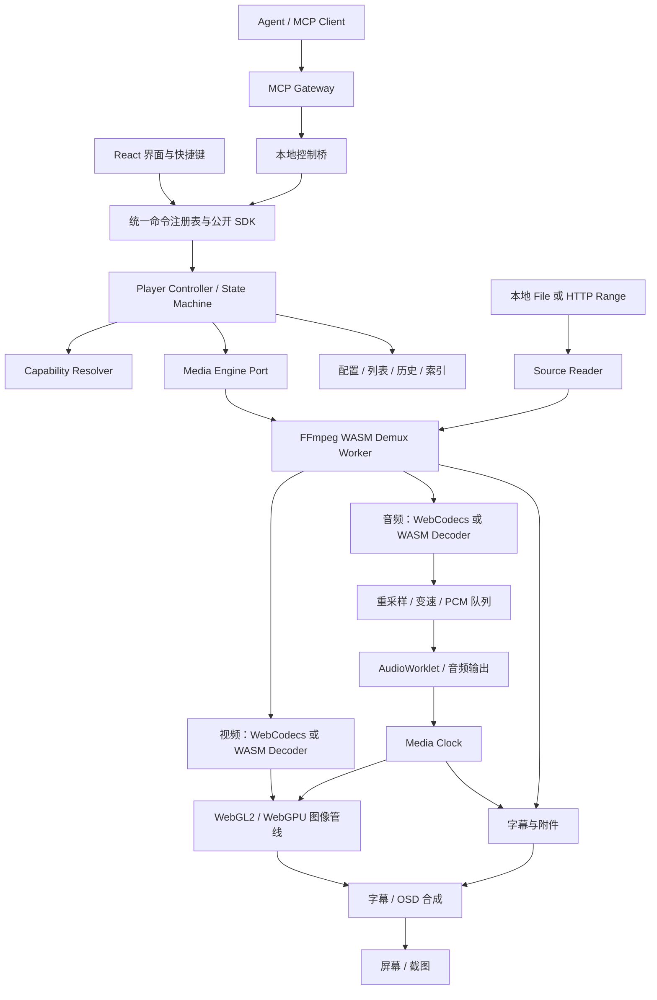

# WASM 视频播放器工程技术方案

日期：2026-11-02。状态：供评审的设计稿，尚未进入实现。

已确认：浏览器优先，以 Web/WASM 实现，可选桌面封装。目标是尽量广的格式覆盖、参考 PotPlayer 的常用及高级设置、简洁大方的界面，以及可由 Agent 调用的完整功能接口。

工程现状：当前工作目录为空，尚未初始化 Git，没有既有代码和架构约束。本稿中的格式、性能、包体积均为建设目标或验证事项，不代表已完成的能力。

## 1. 推荐结论与范围

采用**可控的混合播放管线**：FFmpeg/WASM 负责解封装及软件解码兜底，WebCodecs 优先承担浏览器能够处理的音视频解码，WebGL2/WebGPU 负责画面处理，AudioWorklet 负责连续音频输出。UI、快捷键、Agent 共用同一套命令注册表、能力描述和播放器状态。

这里的 WASM 是播放器内核的重要部分。允许使用浏览器的媒体与 GPU 能力，避免把所有视频都强制交给 CPU 软件解码。

首发重点是桌面浏览器中的本地文件和 HTTP 点播，优先在 Deepin/Linux 的 Chrome、Chromium、Edge 上验证，同时建立 Windows/macOS 对照矩阵。Firefox、Safari 根据实际能力提供兼容等级；手机浏览器列入后续适配，不假定与桌面同等表现。

三个可选方向：

| 方向 | 优点 | 主要代价 | 判断 |
| --- | --- | --- | --- |
| 统一采用 FFmpeg/WASM 软件解码 | 管线一致，便于扩展旧格式 | 高分辨率、高码率视频的 CPU、内存和耗电压力大 | 保留为兜底路径 |
| FFmpeg/WASM + WebCodecs + 自主管线 | 能兼顾格式、性能、画面设置和自动控制 | 需要建设时钟、缓冲、渲染及能力路由 | **推荐** |
| 桌面壳 + 原生 FFmpeg/mpv | 更接近桌面播放器的系统能力 | 增加平台和分发成本，媒体执行不再是纯 Web/WASM | 后续可选产品分支 |

首版不把 AI 超分、运动补帧、蓝光菜单、商业 DRM、Dolby Vision 全链路、独占音频和音频源码直通纳入承诺。它们有独立的性能、平台或授权条件，应分别立项。

## 2. 关键技术事实与选型依据

WebCodecs 提供编解码接口，但不保证某个浏览器支持某种编码，也不承担容器解封装。硬件加速偏好只是提示，不能据此向用户宣称正在硬解；必须探测实际配置并处理运行时失败。[W3C WebCodecs](https://www.w3.org/TR/webcodecs/)

不使用“整个文件先转成 MP4，再播放”作为主链路。ffmpeg.wasm 的公开封装主要面向任务式媒体处理，文件系统进出和资源开销不适合作为大文件播放器的基本数据流；可以用于后续离线导出工具。[ffmpeg.wasm 架构](https://ffmpegwasm.netlify.app/docs/overview/)、[FAQ](https://ffmpegwasm.netlify.app/docs/faq/)

FFmpeg 绑定层优先基于 libav.js 定制构建，复用其低层 API 与虚拟设备 I/O。官方文档提供可寻址的 block reader 设计；默认预编译包不包含本工程需要的全部编码，应自建并验证构建清单。[libav.js](https://github.com/Yahweasel/libav.js)、[设备 I/O](https://github.com/Yahweasel/libav.js/blob/master/docs/IO.md)

libmedia 已有 WebCodecs、WASM、播放管线及分格式能力，是 P0 的对照对象和工程参考；它的解封装主要使用 TypeScript。正式方案不以完整 AVPlayer 黑盒 API 作为领域接口，避免高级渲染和 Agent 接口受其限制。[libmedia](https://github.com/zhaohappy/libmedia/blob/master/README_en.md)

### 建议技术栈

| 层 | 选型 | 职责 |
| --- | --- | --- |
| Web 应用 | React + TypeScript + Vite | 界面、应用装配、PWA；不参与逐帧调度 |
| 控制核心 | TypeScript，框架无关 | 命令注册表、状态机、能力系统、会话与任务 |
| 数据契约 | JSON Schema；可用 Zod 辅助编写与校验 | 为 UI、SDK、MCP 生成一致的输入和输出定义 |
| 媒体基础 | FFmpeg 库 + Emscripten，基于 libav.js 定制 | 解封装、解析、软件解码、重采样及必要过滤器 |
| 浏览器解码 | VideoDecoder、AudioDecoder | 通过配置探测后优先使用；音频和视频分别路由 |
| 图像处理 | WebGL2 为首个兼容后端，WebGPU 为增强后端 | 色彩转换、缩放、调色、锐化、合成 |
| 音频 | Web Audio + AudioWorklet | PCM 队列、主时钟、音量、EQ、通道映射 |
| 字幕 | 文本解析 + JASSUB/libass WASM | SRT/VTT 与完整 ASS/SSA 渲染；位图字幕后续扩展 |
| 存储 | IndexedDB；可选 OPFS；Cache Storage | 设置、历史、索引、缓存及按需下载的 WASM |
| Agent | 官方 MCP SDK 的本地 Node 服务 + TypeScript SDK | 结构化发现、执行、状态读取、任务和事件访问 |
| 验证 | Vitest + Playwright + 原生 FFmpeg 参考输出 | 协议、真实浏览器媒体路径和输出对照 |
| 后续桌面壳 | 优先评估 Electron | 复用 Chromium 管线，并提供文件、窗口等宿主接口 |

不在方案阶段追逐具体小版本。P0 结束前固定 FFmpeg、Emscripten、绑定层、前端依赖与 MCP SDK 的版本/提交和构建镜像，记录兼容矩阵，并以 lockfile 和产物哈希控制升级。

## 3. 总体架构与稳定边界

采用 ports-and-adapters 架构，控制面与媒体数据面分离。



关键边界规则：

1. **播放器状态由 Controller 拥有。** UI store 是投影；Agent 不直接修改 UI 状态，界面也不直接操作 decoder。
2. **全部可操作功能进入注册表。** 菜单、快捷键、命令面板、SDK、MCP 来自同一功能定义。播放、设置、列表、主题、界面面板、诊断、导入导出都包含在内。
3. **媒体实现通过 MediaEngine Port 隔离。** 对外提供 open/play/pause/seek、轨道、设置、统计和事件；FFmpeg 指针与第三方库类型不能进入业务 API。
4. **实际生效值与请求值分开。** 设置返回 requested/effective、应用状态和原因。不能实现的设置不能静默成功。
5. **每次打开媒体或重建管线增加 epoch。** 过期的网络响应、帧、PCM、字幕和回调均不能影响新媒体。
6. **控制修订号与实时遥测分开。** 配置、列表等变更使用 revision 做并发控制；播放进度和帧统计使用独立 event sequence，避免每帧造成版本冲突。
7. **内存受预算约束。** 限制每条队列的字节数和时长；视频帧、音频块和 WASM 句柄必须有明确所有者及释放时机。
8. **浏览器能力由 Host Port 抽象。** 文件选择、全屏、画中画、下载和窗口操作暴露能力条件与失败原因；桌面壳只替换对应宿主实现。

## 4. 格式覆盖策略

“支持格式”拆成容器、音视频编码、字幕、协议、profile/位深以及性能条件，不能只根据扩展名判断。

### 建设目标

| 类别 | 首版重点 | 后续扩展 |
| --- | --- | --- |
| 容器 | MP4/MOV、MKV/WebM、AVI、FLV、TS/M2TS、MPEG-PS/VOB、Ogg、WAV/FLAC | ASF/WMV、RM/RMVB、OGM、裸流及其他经验证的 FFmpeg demuxer |
| 视频编码 | H.264、HEVC、VP8/VP9、AV1、MPEG-2、MPEG-4 Part 2 | VC-1/WMV、RealVideo、Theora、MJPEG、ProRes 等按需求扩展 |
| 音频编码 | AAC、MP3、Opus、Vorbis、FLAC、PCM、AC-3/E-AC-3、DTS | ALAC、APE、WMA、TrueHD 等验证后发布 |
| 字幕 | 外挂和内嵌 SRT、WebVTT、ASS/SSA，MKV 字体附件 | PGS、VobSub 位图字幕、更多字符集与复杂字幕组合 |
| 输入方式 | 拖放/选择 File，具有 CORS 条件的 HTTP(S) 点播和 Range | HLS/DASH，授权目录扫描，可选网络协议桥 |

以上是目标清单。每一项只有在构建清单、样本回归和性能结果三者齐备后，才进入对用户发布的支持矩阵。FFmpeg 的上游支持不等于当前 WASM 构建已启用，也不等于目标设备能够实时播放。

### 路由规则

1. 读取文件头并探测 stream、codec、profile、level、位深、色彩与附加信息。
2. 用完整 extradata/config 探测对应 WebCodecs decoder；浏览器支持时优先使用。
3. 音轨和视频轨独立选路。例如视频由 WebCodecs 解码，DTS 音轨由 WASM 解码。
4. 不支持或运行时失败时，在当前播放点附近关键帧重建相应 WASM 解码路径；保留轨道、播放位置和兼容的设置，并发布路径变更事件。
5. WASM 路径依然达不到实时速率时，清楚报告性能不足；允许用户降低倍速或使用可选原生增强。缩小最终画面通常不能消除高分辨率解码开销，不能把它当通用解法。
6. 可选 NativeEngineAdapter 留给后续 MSE、原生 HLS 或 DRM 产品需求。进入该路径前重新计算能力；首版不让原生播放快路径分散自主管线的建设。

对外描述使用 `decodePath = webcodecs | wasm | native`。只有具有可靠诊断证据时才声明硬件加速，否则 `acceleration = unknown`。`isConfigSupported()` 不能证明实际采用硬件。

4K/高码率/10-bit/高帧率视频以浏览器可用的高效解码路径为主要目标；不承诺所有设备通过 WASM 达到 4K 实时。

## 5. 数据读取、WASM 构建与内存

### 增量、可寻址 I/O

定义 `SourceReader` 的 readAt、getSize、cancel、close 与能力描述。FileReader 使用 `Blob.slice()`，HTTPReader 使用 Range 和 AbortController。接入 libav.js 的 block reader 或等价 AVIO 绑定，禁止常规路径把整个电影写入 MEMFS。

HTTPReader 验证实际的 206/Content-Range 响应，不只检查 Accept-Ranges。对不支持 Range 的源提供有界顺序读取；不能随机跳转时将 seek 能力设为不可用，必要时让用户明确选择完整下载到磁盘缓存。用 ETag/Last-Modified 等检测跨请求资源变化。MP4 尾部索引、MKV cue、缺失索引与损坏时间戳分别处理。

媒体文件可以大于 WASM 线性内存。文件大小与寻址正确性由 reader 和绑定层验证，运行时只持有活动窗口；不把某个任务式封装的文件大小上限误当成所有 WASM 播放器的上限。

### 功能包与构建

建议分为 demux-common、decode-audio-common、decode-video-common、legacy-formats、subtitle-bitmap 等独立构建包。包内可以包含一组功能，减少首包和重复加载开销；不假定所有 FFmpeg codec 都能无成本拆成独立动态库。

每个 WASM 实例拥有独立内存和句柄空间。跨包只传可序列化 codec 参数、编码包或帧数据，禁止跨实例传 FFmpeg 指针。编译产物附带 machine-readable manifest：源版本、configure 参数、codec/demuxer/filter 清单、ABI、SIMD/线程要求、哈希和许可证。

发布单线程构建与单独的多线程构建。支持 SIMD 时按实测选择优化版本；SIMD 或线程都不等于必然加速。Emscripten 明确要求针对有/无线程环境提供不同二进制。[SIMD 文档](https://emscripten.org/docs/porting/simd.html)、[Pthreads 文档](https://emscripten.org/docs/porting/pthreads.html)

### 资源预算

- 主线程只处理 UI 和控制；demux、软件解码、图像处理分别进入 Worker 或适当执行上下文，支持程度由启动探测决定。
- 软件音频解码、重采样和复杂变速在 Worker 完成，AudioWorklet 的实时回调只做有界操作，避免 I/O、长任务和无界分配。
- PCM 使用环形缓冲。支持跨源隔离时使用 SharedArrayBuffer；不支持时使用可转移 ArrayBuffer 池和更保守的缓冲策略。
- 视频队列初始按约 3–6 帧设计，同时按字节数和时间限制，不能用固定大量帧覆盖所有分辨率。8-bit 4K YUV420 一帧约 12 MiB，10-bit 常用 16-bit 存储时约翻倍。
- `VideoFrame`、`AudioData` 使用后立即 close；WASM heap、网络缓存、GPU texture、字幕字体和截图读回分别记账。
- 以“首版桌面 1080p 常规播放，已记账媒体资源预算约 256 MiB”为初始调优目标；4K 单独制定预算。浏览器、驱动和隐藏解码缓冲另计，P0 实测后调整。
- 低于上游消费速率时实施背压，不能用不断增加队列掩盖问题；停止、切片、重新打开必须能释放整条管线。

## 6. 时间系统与播放正确性

有音频时，以实际已消费的 PCM 样本对应的媒体时间作为主时钟，结合 AudioContext 输出时间信息校正设备输出位置；不能简单用系统时间或 setInterval 推进进度。静音继续维持时间线；无音轨时使用可暂停、可变速的单调时钟。[Web Audio 1.1](https://www.w3.org/TR/webaudio-1.1/)

解封装保存原始 time_base、PTS/DTS、duration 和 discontinuity；内部使用有理数/安全整数转换策略，避免长视频累计误差。B 帧按解码顺序输入，画面按呈现时间调度。

视频提前时等待，适度落后时丢弃过期显示帧；解码严重落后时重同步。不能随意丢弃后续解码依赖的编码包。VFR 使用实际 PTS，不依赖固定 fps。

精确 seek 流程：取消旧读取 → 增加 seek epoch → 清空过期帧和 PCM → 定位前一个关键帧 → 重置解码器 → 解码并跳过目标前的输出 → 根据实际音频/视频时间重建时钟 → 恢复播放。返回实际定位时间和误差。

首版支持暂停时向前逐帧。反向逐帧在后续通过回退到前一关键帧、正向解码和有界帧缓存实现，代价按 GOP 长度限制。负速率连续倒放不属于初版。

音画延迟、字幕延迟分别定义符号：正值表示相应轨道更晚呈现；调整音频延迟后重新计算时钟映射，避免相同偏移叠加两次。倍速统一改变 media-time 映射，保留音调的处理器延迟也必须计入。

状态机至少覆盖 idle、opening、ready、playing、paused、buffering、seeking、ended、error、disposed。用户激活要求作为当前操作的条件返回，不把“等待用户点击”错误报告为播放中。

## 7. 参考 PotPlayer 的设置能力

目标是保留丰富的能力，并通过搜索、分组、预设和渐进展示控制复杂度。

| 分组 | 首版与核心增强功能 | 实现要点 |
| --- | --- | --- |
| 播放 | 播放/暂停/停止、跳转、0.25–4 倍速、单文件/列表循环、A-B 循环、前向逐帧、章节、断点续播 | 统一状态机与时钟；倍速范围表示接口范围，具体可用性由性能决定 |
| 画面几何 | 适应窗口/填满/原始尺寸、自定义宽高比、旋转、水平/垂直翻转、缩放、平移、裁切 | 明确源坐标与显示坐标，保存可逆变换参数 |
| 画面颜色 | 亮度、对比度、饱和度、色相、Gamma、RGB 增益/色温、预设、恢复默认 | GPU shader，规定单位、默认值和处理色域 |
| 画质增强 | 最近邻/双线性/高质量缩放、锐化；后续轻量降噪、去隔行、HDR→SDR | 按设备能力和吞吐暴露；不将 CSS filter 作为最终图像管线 |
| 音频 | 音轨、静音、音量/增益、左右平衡、单/双声道、混音、延迟、10 段 EQ | 重采样和声道映射清晰；增益后设置防削波策略 |
| 音频增强 | 保留音调变速、压缩/响度控制、动态范围、输出设备选择 | 分阶段启用；扬声器布局和设备切换受平台条件影响 |
| 字幕 | 内嵌/外挂、主副字幕、字体/字号/颜色/描边/阴影/位置、延迟、编码选择 | 双字幕轨；ASS 默认尊重原样式，提供显式强制覆盖模式 |
| 列表与资料 | 文件批量加入、排序/重排、上一条/下一条、历史、书签、媒体与轨道信息 | 目录读取依赖已授权句柄，普通 File 列表不持久化假路径 |
| 应用与工具 | 主题、快捷键、命令面板、全屏、可用时的画中画、截图、设置/预设导入导出、诊断 | 都进入命令注册表；截图可选择字幕/OSD；导出任务可取消 |

### 图像处理管线

入口区分两种帧：WASM 输出原始 YUV，需要按 range、matrix、transfer、primaries 做转换；WebCodecs/GPU 外部纹理路径可能已执行部分色彩转换，不能再做一次。入口必须附带明确的像素与色彩契约。

逻辑顺序：入口规范化 → 必要的去隔行 → 色彩转换/HDR→SDR → 几何与缩放 → 用户调色 → 锐化/增强 → 字幕 → OSD。每步说明工作色域，输出统一到目标画布色彩空间。WebGPU 为渲染和计算 API，不能据此假设完整 HDR 显示链已经成立。[WebGPU 规范](https://www.w3.org/TR/webgpu/)

首版按 SDR 输出验收；10-bit 解码、HDR→SDR 与显示器原生 HDR 是三种不同能力。缺失色彩元信息时记录采用的推定值，并允许高级覆盖。高质量缩放和高成本滤镜可动态降级，但必须报告实际有效设置。

### 字幕

JASSUB/libass 处理复杂 ASS/SSA，使用播放器主时钟进行手动渲染，支持不绑定 HTMLVideoElement 的画布播放路径。字幕字体优先来自文件附件、随应用提供的字体或用户导入字体；在线字体获取为显式选项。[JASSUB](https://github.com/ThaUnknown/jassub)

处理文本编码、字体缺失、画面裁切后的字幕位置和主副字幕冲突。PGS/VobSub 后续通过 FFmpeg 位图字幕解码适配到同一合成层，可能需要补充 libav.js 没有暴露的字幕绑定。

## 8. 简洁大方的界面设计

默认深色中性界面，采用少量 Deepin 风格的蓝色强调、清晰层次、适度圆角和足够留白。观看区域以内容为主，减少持续覆盖视频的控件。

- 顶栏：打开文件、当前标题、列表、设置、Agent 连接状态。
- 中部：视频画布、字幕和短暂 OSD；空状态保留“打开视频”和拖放提示。
- 底部：时间线、时间、播放控制、音量、倍速、音轨/字幕、全屏。
- 右侧抽屉：列表或设置，默认关闭；设置按“画面、音频、字幕、播放、应用”分组，提供跨组搜索。
- 复杂项进入“高级”，预设可一键恢复；控件显示当前值、单位、默认值和是否已生效。
- Ctrl+K 命令面板来自注册表，可以搜索“亮度”“字幕延迟”“跳到时间”等；快捷键可配置。
- Agent 状态标记可展开最近操作、当前连接及断开控制；正常观看时不占据侧栏。

紧凑窗口使用覆盖抽屉，宽窗口允许设置与画面并排。全键盘导航、可读焦点、足够对比度和 reduced-motion 为基础要求。帮助信息优先解释用户可采取的操作，而非暴露底层实现细节。

## 9. Agent 对全部功能的结构化控制

### 功能注册表

每个 action 注册：稳定 ID、中文/英文名称、输入/输出 schema、能力前提、是否需要媒体、执行方式、可取消性、状态读取方式、相关事件和可用于 UI 的元信息。

设置项另有取值范围、单位、默认值、作用域、是否需要重建管线和当前生效条件。公开 schema 使用稳定字段，禁止任意字符串路径写入内部对象。

建议先固定以下参数约定，防止 UI 百分比与 Agent 数值含义不同：

| 参数 | 接口范围与默认值 | 语义 |
| --- | --- | --- |
| video.brightness | -1 至 1，默认 0 | 在规定的 SDR 调色域中增加亮度偏移；UI 可显示 -100 至 100 |
| video.contrast、video.saturation | 0 至 2，默认 1 | 中性值为 1，UI 可显示百分比 |
| video.gamma | 0.1 至 5，默认 1 | 定义为输出等于输入的 1/gamma 次方；大于 1 提亮 |
| video.hueDeg | -180 至 180，默认 0 | 色相旋转角度 |
| video.rotationDeg | 0、90、180、270，默认 0 | 顺时针旋转 |
| video.crop | 左/上/右/下归一化边距，默认全 0 | 每项非负，横向/纵向之和均须小于 1；以源画面为基准 |
| audio.volume | 0 至 1，默认 1 | 主音量；超出单位增益由单独 gainDb 控制 |
| audio.gainDb | -24 至 12，默认 0 | 额外增益，最终输出带防削波处理 |
| audio.delayMs、subtitle.delayMs | -10000 至 10000，默认 0 | 正值使该轨道更晚呈现 |
| playback.rate | 0.25 至 4，默认 1 | 请求倍速；实际可用范围由能力和性能结果约束 |

HDR 或其他图像处理域必须使用不同的显式模式和描述，不能让同一个 brightness 数值在不同解码后端随意改变含义。以上是首版契约建议，P0 调整时同时修改 schema、UI 显示和 Agent 描述。

“全部可控”的验收定义：**所有已发布的可操作功能均可发现、可调用、可读回结果；外部条件不满足时返回准确原因。** 不能把无法绕过的浏览器权限或用户激活条件描述成无条件自动化。

### API 与 MCP 工具分组

| 工具/操作组 | 功能 |
| --- | --- |
| sessions.list、sessions.attach | 发现并选择具体标签页/播放会话，避免控制错实例 |
| capabilities.get、actions.list | 当前 source/engine/host 的可用功能、schema、条件与原因 |
| sources.list、media.open、media.close、media.probe | 已授权源、URL、媒体打开关闭和信息探测 |
| playback.set、playback.seek、playback.step、loop.set | 播放状态、倍速、跳转、逐帧、循环 |
| tracks.list、tracks.select、subtitles.load | 音视频和字幕轨道、外挂字幕与字体 |
| settings.describe、settings.get、settings.apply、settings.reset | 视频/音频/字幕/播放/应用设置，含预设 |
| playlist.*、bookmarks.*、history.* | 列表、书签和历史管理 |
| ui.set、host.request | 设置面板、主题、命令面板、全屏、画中画和宿主操作 |
| capture.create、presets.*、config.import/export | 截图、预设、配置导入导出 |
| state.get、events.read、diagnostics.get | 实际状态、带游标的事件、播放统计与故障原因 |
| jobs.get、jobs.cancel | 打开/定位/截图/导出等耗时任务的最终结果和取消 |

工具数量以场景组织，避免把每个滑杆都独立注册成一个 MCP tool。设置定义由 settings.describe 暴露；类型化 patch 仍须逐字段校验。SDK 与 MCP 输出使用同一 schema，不单独维护一套功能清单。

### 命令语义

每次调用带 requestId、sessionId、可选 expectedRevision、action 和 params。返回 requestId、状态、revision、requested/effective、错误或 jobId。requestId 用于有限时间窗口内去重，不让重试重复加入列表或重复导出。

耗时操作先返回 accepted + jobId，完成后才能返回或查询 applied。单纯收到消息不代表音频、图像或导出已经生效。seek 等连续交互可合并旧请求；队列增删和导出不能任意合并。

配置 patch 先整体校验，再提交期望状态。多个 DSP/GPU/解码器的实际切换可能无法成为一个物理原子事务，需要逐域报告 applying/applied/failed 与有效值；重建失败保留或恢复旧有效配置。批量命令按序执行并返回逐项结果，不承诺跨副作用的全局回滚。

建议稳定错误码：UNSUPPORTED、NEEDS_MEDIA、NEEDS_USER_GESTURE、SOURCE_NOT_AUTHORIZED、REVISION_CONFLICT、PERFORMANCE_LIMIT、DECODE_FAILED、CANCELLED、SESSION_CLOSED、TIMEOUT。错误同时包含可执行的恢复建议。

调用示例，以下是领域调用结构，并非额外的 MCP 标准协议格式：

```json
{
  "requestId": "req-1042",
  "sessionId": "player-7",
  "expectedRevision": 18,
  "action": "settings.apply",
  "params": {
    "scope": "session",
    "patch": {
      "video": { "brightness": 0.08, "contrast": 1.1 },
      "subtitle": { "delayMs": 500 },
      "playback": { "rate": 1.25 }
    }
  }
}
```

例如 Agent 可以先查询当前音轨/字幕及能力，切换中文音轨和字幕，将字幕延后 500 ms，设置 1.25 倍速，跳转到 10:00，等待定位完成后截图，再读回位置、轨道、图像设置与任务结果。

### MCP 如何连接浏览器

浏览器页面无法自行监听本地端口作为通用 MCP 服务。推荐首发提供一个**本地 MCP Companion**：它通过 stdio 接入 Agent，同时以 loopback HTTP 托管同源 Web 页面和控制 WebSocket。页面主动连接控制桥，Agent 与页面之间只传控制/状态和显式请求的结果，媒体文件仍由浏览器解码。

标准 MCP 接口使用 stdio；后续远程连接可加 Streamable HTTP，并跟随客户端支持范围做协议版本兼容。WebSocket 是 Companion 与页面之间的内部协议，不对外宣称为标准 MCP transport。[MCP Transports](https://modelcontextprotocol.io/specification/latest/basic/transports)

| 使用方式 | 运行组件 | Agent 连接 |
| --- | --- | --- |
| 直接访问静态站/PWA | 浏览器，无常驻后端 | 应用内 Agent 可直接调用 SDK；外部 Agent 需选择连接方式 |
| 本地 Agent 联动，首推 | Companion + 浏览器打开其 loopback 地址 | MCP stdio → Companion → 同源页面 |
| 已部署网站接入外部 Agent | 可选同源控制 relay + 浏览器 | MCP 服务和页面主动连 relay；单独配置身份和配对 |
| 后续桌面封装 | 桌面壳 + 同一控制核心 | MCP → 宿主 IPC；复用公开命令 |

不依赖 HTTPS 网站直接访问任意 ws://localhost。已部署站点采用同源 WSS relay，或独立验证过的扩展方案，避免混合内容、浏览器本地网络权限和隔离策略造成隐含前提。远程 relay 不是本地播放器的必选依赖。

Companion 限定 loopback、校验 Host/Origin、使用会话密钥并明确目标会话，防止其他网站接管。配对和授权可撤销，播放过程不要求每调一次亮度都确认。媒体文件名、字幕及元数据只能作为数据，不能作为 Agent 指令。

### 文件、全屏与用户激活边界

纯 Web 以 File、已授权目录句柄或 URL 作为 source，不接受一个绝对路径就宣称能读取本地文件。首次文件/目录授权由浏览器用户完成；后续 Agent 可访问授权范围内注册的 sourceId。授权失效时需要重新授权。[File System Access](https://developer.chrome.com/docs/capabilities/web-apis/file-system-access)

需要 Agent 从本地路径直接打开文件时，Companion 可显式启用目录范围内的 file broker：规范化路径并防止符号链接逃逸，向页面提供受鉴权的同源 Range URL。该模式是可选本地服务能力，不改变解码仍在浏览器的事实。

全屏、部分画中画、音频启动、下载/文件选择可能有用户激活条件。普通脚本发起的 click 不能作为通用绕过方式。必须按 API 和运行时状态返回条件；已激活的媒体播放可继续由 Agent 控制，但全屏等可能仍要求当次交互。若要求完全无人值守的系统级操作，应选择桌面宿主接口。[HTML 用户激活模型](https://html.spec.whatwg.org/multipage/interaction.html)

## 10. 配置、历史与插件扩展

设置合并顺序：内置默认 → 用户全局 → 用户选定预设/媒体规则 → 当前会话覆盖。必须允许 UI 与 Agent 查询一个有效值来自哪层，并逐层恢复默认，避免恢复操作被其他层立刻覆盖。

IndexedDB 保存版本化设置、播放历史、书签、列表和可持久化文件句柄；恢复句柄时检查权限，普通 File 在页面关闭后按失效源处理。媒体身份使用大小、修改时间和局部内容摘要辅助匹配，避免只靠文件名。

OPFS 作为可选的索引、缓存或显式导入存储，配额不足时可清理或禁用；不默认复制全部视频。PWA 离线只保证已缓存应用及已下载所需 codec 包可用，不能保证从未下载的解码包离线可用。

第一阶段仅做构建时可插拔适配器。第三方运行时代码插件留待后续权限模型完成后考虑；新增官方滤镜或工具必须注册 schema、能力条件、命令与结果读回，保持 Agent 覆盖率。

## 11. 部署、分发与依赖条件

静态播放器可由支持响应头的 HTTPS 服务部署。所有 Worker、WASM 和基础字体优先同源提供，使用内容哈希和版本化 manifest，缓存更新不能混用不同 ABI 的 JS 与 WASM。

多线程增强模式需要跨源隔离，基础部署配置为：

```http
Cross-Origin-Opener-Policy: same-origin
Cross-Origin-Embedder-Policy: require-corp
Content-Type: application/wasm
```

前两项是文档隔离策略；第三项用于 WASM 文件。根据实际部署给 Worker/资源设置相应响应头。启动时检查 crossOriginIsolated，不满足则切换单线程产物，而非整个应用无法启动。[COOP/COEP](https://web.dev/articles/coop-coep)

跨域媒体 fetch 仍然要求 CORS；CORP 不能代替 JavaScript 读取所需的 CORS。字体、字幕、远程媒体和用户凭据都要在隔离条件下验证。代理只能作为用户配置的可选能力；若实现网络代理，需要限制可访问目标、验证重定向，不能成为开放转发服务。

浏览器没有通用原生 TCP/UDP socket，RTSP/RTMP/SRT 等不因“使用 FFmpeg”就自动获得直连能力。需要单独的 WebSocket/WebTransport/WebRTC 或服务端协议桥，首版不列为无条件支持。

可选桌面封装优先评估 Electron，以降低 Chromium 播放管线的差异。Tauri 在 Linux 使用 WebKitGTK，需要重新验证 WebCodecs、WebGPU、线程与媒体支持，不把换壳视为零成本。[Tauri Webview Versions](https://v2.tauri.app/reference/webview-versions/)

Electron 使用有限的 preload IPC、contextIsolation 和沙箱；桌面宿主能力沿用 Host Port，不向界面暴露通用 shell 执行接口。[Electron Security](https://www.electronjs.org/docs/latest/tutorial/security)

FFmpeg 的分发许可取决于具体构建选项和依赖。默认构建避免 enable-gpl/enable-nonfree；保存对应源码、修改、构建脚本和第三方声明，逐个核验字幕、变速和 codec 依赖。WASM 单独成文件不自动解决全部许可要求，项目许可证在分发方式确定时一起确认。[FFmpeg 许可说明](https://ffmpeg.org/legal.html)

## 12. 建议工程结构

```text
apps/
  web/                       # React 页面、PWA、UI 组件
  companion/                 # MCP stdio、本地同源控制桥、可选文件代理
  desktop/                   # 后续桌面壳
packages/
  contracts/                 # commands、schemas、events、capabilities
  player-core/               # Controller、状态机、设置与会话
  media-engine/              # engine port、路由、时钟、缓冲与调度
  source-readers/             # File、HTTP Range、授权源
  ffmpeg-adapter/             # libav.js 适配、WASM 加载及句柄管理
  webcodecs-adapter/          # config、extradata、packet/chunk 转换
  renderer/                  # WebGL2/WebGPU、色彩、滤镜和截图
  audio/                     # PCM、AudioWorklet、EQ、混音与变速
  subtitles/                 # cue、ASS、字体与双字幕合成
  storage/                   # 设置、历史、索引与迁移
  agent-sdk/                 # 类型化调用与事件客户端
  mcp-server/                # 从注册表生成工具的协议适配
  host/                      # BrowserHost、CompanionHost、DesktopHost
native/
  ffmpeg-bindings/            # 需要补充的精简 C 接口
  builds/                    # 固定镜像、构建清单、ST/MT 与功能包
tests/
  fixtures/                  # 经授权的微型样本及 manifest
  compatibility/             # 容器×编码×浏览器×路径结果
  e2e/                       # UI、SDK、MCP 的关键流程
docs/
  superpowers/specs/         # 技术方案和后续评审稿
```

这是模块边界建议，允许初期合并包以减少工程管理成本，但不能把公开契约、浏览器 UI 和 FFmpeg 内部状态耦合在一起。

## 13. 实施阶段与完成条件

时间为具有媒体工程经验的两名主要开发人员和共享测试支持下的粗估；性能验证与绑定层工作存在明显不确定性。先过 P0，再据结果承诺排期。

| 阶段 | 参考时间 | 交付与退出条件 |
| --- | --- | --- |
| P0 可行性验证 | 1–2 周 | 固定构建；MP4/MKV 混合解码；一个旧格式软解；大文件随机读取；音频时钟和 seek；滤镜；无视频元素的 ASS；MCP 控制闭环；性能报告 |
| P1 可用播放器 | 3–4 周 | 本地文件/HTTP、目标常见格式、轨道、字幕、列表、历史、基础设置、简洁 UI；MCP 和 SDK 从首版同时可用 |
| P2 核心高级能力 | 3–4 周 | 调色/几何/缩放/锐化、EQ/音频延迟/保留音调变速、双字幕、A-B 循环、预设、截图与设置导入导出 |
| P3 扩展与稳定 | 3–5 周 | 旧格式包、位图字幕、反向逐帧、HDR→SDR、HLS/DASH 按优先级纳入；兼容矩阵、内存与长稳验证 |
| P4 可选桌面增强 | 单独评估 | 文件关联、目录访问、窗口控制、MCP 无人值守宿主操作；若增加原生解码需独立验收 |

常用能力完整的 Web 首版可按约 10–14 周量级讨论；全部 P3 长尾能力需要更多时间，不能把“接近 PotPlayer 的全部能力”当作同一短周期的范围。

### P0 必须回答的问题

1. 本地超过 4 GiB 的真实媒体能否按需读取、随机定位，且常驻缓冲不随总文件大小增长？
2. MP4/H.264/AAC、MKV/HEVC/AC-3、WebM/VP9/Opus、AVI/MPEG-4/MP3 的目标样本，能否使用真实浏览器 decoder 路径并正确同步？
3. 在硬件/浏览器不支持目标配置、解码器运行时失败及没有 SharedArrayBuffer 时，能否正确回退并释放旧资源？
4. 色彩调节、ASS 合成、音频输出与定位重建能否同时工作？
5. Deepin/Linux 目标机上，实际 WebCodecs 支持、解码吞吐、图像路径和 GPU 故障表现如何？
6. Agent 经 Companion 调用设置、seek、截图、读回结果时，是否与 UI 操作同样生效？

若低层绑定成本超出 P0 预算，可将 libmedia 作为加速替代进行同一套验证。替换只允许发生在媒体适配层，必须证明滤镜、帧/时钟控制、资源释放及 Agent 所需能力都可实现；不能仅凭 demo 能播放就切换架构。

## 14. 验证矩阵与验收指标

下面是拟定的验收目标，尚无实测结果。P0 固定基准机器的 CPU/GPU/内存/驱动、浏览器版本与样本码率，避免“所有电脑都流畅”的不可检验承诺。

| 维度 | 验收方式/初始目标 |
| --- | --- |
| 格式正确性 | 容器×codec/profile/位深×音轨×字幕组合；针对启用的每个格式包生成可追溯报告 |
| 混合路径 | WebCodecs 视频+WASM 音频、全 WASM、无音轨、只有音频、mono/多声道分别验证 |
| 常用播放性能 | 基准机 1080p30 主流样本、预热后连续 10 分钟，显示掉帧率目标 <1%；软件重编码和导出另计 |
| 音画同步 | 稳定播放同步误差目标 P95 <50 ms；长视频、倍速、轨道切换和 seek 后重新验证 |
| 定位 | 已索引本地普通 GOP 样本的 seek 完成目标 P95 <1 s；精确视频定位误差不超过目标附近一帧间隔；长 GOP 独立记录 |
| 首帧 | 基准机常用本地样本预热后目标 <1 s，冷启动含 WASM 下载/编译另报；网络源分开评估 |
| 大文件 | >4 GiB 实片与尾索引样本可读取/定位，无整文件内存复制；额外使用稀疏/模拟 reader 检验大偏移边界 |
| 资源释放 | 连续开关/切换 100 次，队列、句柄、帧和纹理计数回到基线，无持续上升；结合浏览器进程内存观察 |
| 长稳与恢复 | 两小时播放、切后台恢复、网络断开/Range 失败、GPU context/device lost、文件损坏、Worker 中断 |
| 画面质量 | 色条/灰阶/不同 range 和 matrix 的参考图，对照原生 FFmpeg；不同 GPU 后端给容差，不盲目要求逐像素一致 |
| 声音质量 | 重采样、声道映射、增益削波、变速和延迟，用已知 PCM 信号及听测交叉验证 |
| Agent 完整性 | 所有已发布 UI 操作都映射到公开命令，注册表覆盖率 100%；端到端抽查实际播放/画面/音频结果 |
| Agent 稳定性 | 多标签页隔离、重复 requestId、旧 revision、取消、超时、掉线重连、无授权与需要用户手势的错误语义 |
| 降级 | 无 WebCodecs、无 WebGPU、无 SAB、OPFS 配额不足、只读源、不可 seek 源都有明确可用能力 |

测试使用可再分发或自生成的小样本；大文件采用专门环境。Headless 环境可能缺失目标 codec、音频设备和 GPU 路径，不能用所有 API 都被 mock 的测试代替真实浏览器验收。CI 跑协议与功能回归，媒体性能必须在有记录的实体机或合适的 GPU 测试环境执行。

## 15. 主要风险及处理顺序

| 风险 | 处理 |
| --- | --- |
| 高码率 HEVC/AV1 软解达不到实时 | WebCodecs 优先，P0 基准，公开性能等级；原生增强单独提供 |
| FFmpeg WASM 体积与初始化过大 | 功能分包、按需加载、同源缓存；冷/热启动分别计量 |
| 大文件和 seek 绑定复杂 | 先验证 block reader、Range、索引和取消；不以 MEMFS demo 作为通过标准 |
| Linux 浏览器/驱动差异 | 目标 Deepin 实机优先，记录版本与路径，禁止仅靠 UA 宣称支持 |
| 音画不同步与 seek 残留 | 单一时间映射、epoch 隔离、可观测队列和长稳测试 |
| UI 设置与 Agent 行为分叉 | 单一注册表、同一 Controller、设置请求/生效分离与读回验证 |
| 浏览器权限妨碍完全自动化 | 句柄/sourceId 和可选 Companion file broker；系统操作用桌面 Host |
| 长尾范围持续膨胀 | 以实测支持矩阵发布，P3 能力逐包交付，首版围绕常用场景完成 |

下一步应先评审这份架构和功能分期，再按 P0 的退出条件编写实施任务；当前没有初始化项目、引入依赖或开始播放器实现。
